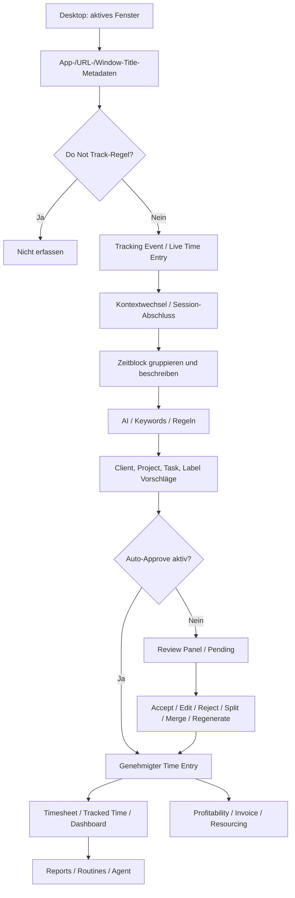

# Rize – Vollständiger Feature-Katalog 2026

**Recherche-Stand:** 20. Oktober 2026  
**Produkt:** [Rize](https://rize.io/) – automatisches Time-Tracking, KI-gestützte Zuordnung, Arbeits- und Team-Analyse, Fokusunterstützung sowie Abrechnung.  
**Primärquellen:** [Rize-Dokumentation](https://docs.rize.io/), [Feature-Übersicht](https://rize.io/features), [Changelog](https://rize.io/changelog/all), [Preise](https://rize.io/pricing).  
**Wichtiger Stichtag:** Am **20. Oktober 2026** wurde ein umfassend überarbeitetes UI einschließlich neuer Navigation und Funktionen veröffentlicht. Die vorliegende Bestandsaufnahme orientiert sich **vorrangig an diesem Release**. [Q01] [Q02]

> **Abdeckungs- und Verifizierungsgrenze:** „Vollständig“ bedeutet hier: möglichst vollständige öffentlich belegbare Funktionsinventur zum Stichtag, **keine** Behauptung, dass sämtliche Rollen-, Lizenz-, OS-, Feature-Flag- oder Beta-Varianten durch einen eingeloggten Account manuell getestet wurden. Rize ändert UI, Menünamen und Rollout regelmäßig. Bei abweichenden Dokumentationsversionen gilt der Stand der neueren Produktdokumentation bzw. des Changelogs; Widersprüche sind markiert.

## Legende

| Kennzeichen | Bedeutung |
|---|---|
| **[BELEGT]** | Explizit in aktueller offizieller Dokumentation oder Changelog beschrieben. |
| **[BETA]** | Öffentlich als Beta oder eingeschränktes Rollout benannt. |
| **[PLAN-/ROLLENABHÄNGIG]** | Sichtbar/nutzbar abhängig von Lizenz, Workspace, Rechten oder aktivierter Funktion. |
| **[ANGEKÜNDIGT]** | Als *coming soon* angekündigt, zum Stichtag nicht als verfügbar belegen. |
| **[LEGACY]** | Historisch dokumentiert; nicht als aktuelle Navigation voraussetzen. |
| **[UNKLAR]** | Die öffentlich verfügbaren Quellen legen genaue Verfügbarkeit, Benennung oder Verhalten nicht ausreichend fest. |

## Inhaltsverzeichnis

1. [Produktüberblick und Plattformen](#1-produktüberblick-und-plattformen)
2. [Informationsarchitektur und vollständige Navigation](#2-informationsarchitektur-und-vollständige-navigation)
3. [Agent: Home, Routines, Focus](#3-agent-home-routines-focus)
4. [Track: Calendar, My Timesheet, Meetings, Apps](#4-track-calendar-my-timesheet-meetings-apps)
5. [Analyze: Tracked Time, Resourcing, Profitability, Productivity, Reports, Dashboards](#5-analyze-tracked-time-resourcing-profitability-productivity-reports-dashboards)
6. [Work: Tasks, Projects, Clients](#6-work-tasks-projects-clients)
7. [Admin: Teams, Members, Invoices, Settings](#7-admin-teams-members-invoices-settings)
8. [Settings: ausführliches Konfigurationsinventar](#8-settings-ausführliches-konfigurationsinventar)
9. [KI-System, Erkennungsregeln und Datenlebenszyklus](#9-ki-system-erkennungsregeln-und-datenlebenszyklus)
10. [Rollen, Scopes und Sichtbarkeit](#10-rollen-scopes-und-sichtbarkeit)
11. [Integrationen, GraphQL, Webhooks und MCP](#11-integrationen-graphql-webhooks-und-mcp)
12. [End-to-End-Workflows](#12-end-to-end-workflows)
13. [Fachliches Datenmodell und Zustandsübergänge](#13-fachliches-datenmodell-und-zustandsübergänge)
14. [Tarife, Credits und Plattformbeschränkungen](#14-tarife-credits-und-plattformbeschränkungen)
15. [Datenschutz und Sicherheitsmodell](#15-datenschutz-und-sicherheitsmodell)
16. [Änderungen 2026, offene Punkte und Unschärfen](#16-änderungen-2026-offene-punkte-und-unschärfen)
17. [Quellenverzeichnis](#17-quellenverzeichnis)

---

# 1. Produktüberblick und Plattformen

## 1.1 Kernversprechen

Rize erfasst auf dem Desktop Hintergrundereignisse zum gerade aktiven Programm/Fenster und wandelt sie in nachvollziehbare Arbeitszeit-Einträge um. Die Kernkette lautet:

`Aktives Fenster → Tracking-Event → Zeitblock → Titel/Beschreibung → Client/Project/Task/Label-Vorschläge → Review/Freigabe → Analyse/Timesheet/Profitabilität/Rechnung`.

Zusätzlich bietet das Produkt Fokus-Sitzungen, Pausenerkennung, Meeting-Erkennung, individuelle Produktivitätsmetriken, Teams und Organisationen, Projekt- und Kundendaten sowie KI-Agenten, Reports und Automatisierungen. [Q03] [Q04] [Q05]

## 1.2 Produktoberflächen

| Oberfläche | Funktion | Wesentliche Grenze |
|---|---|---|
| **Desktop-App macOS** | Automatische Aktivitäts-/Fenstererfassung, Kalender, Fokus-Timer, Review, Analyse, Teamfunktionen | Erfordert Installation/Berechtigungen; genaue Mindestversion siehe Preis-/Download-Seite. |
| **Desktop-App Windows** | Entsprechendes Desktop-Tracking und Desktop-UI | Plattformabhängige Fenster-/Browser-Informationen und Berechtigungen. |
| **Web-App** | Navigation, Analyse, Agent, Dashboards, Administration, Bearbeitung; „Open in browser“ von der Desktop-App aus | **Kein Ersatz für den Desktop-Tracker**: automatische lokale Erfassung benötigt weiterhin die Desktop-App. [Q01] |
| **Externe KI-Clients** | Zugriff über MCP auf freigegebene Daten und Aktionen | OAuth, Benutzerrechte, API-/AI-Limits. [Q30] |
| **Mobile** | Enterprise-Marketing erwähnt Mobile-Angebot | **Nicht** als allgemeine iOS-/Android-Tracking-Parität nachgewiesen; [UNKLAR]. [Q38] |
| **Linux** | In Produktinformationen als künftige Plattform erwähnt | **[ANGEKÜNDIGT]**, nicht als allgemein unterstütztes Desktop-Tracking zählen. [Q38] |

## 1.3 Zielgruppen und Einsatzfälle

- Einzelpersonen: Fokuszeit, Ablenkungen, Kalender, private Auswertung, automatische Zeiterfassung.
- Freelancer/Beratung: kunden- und projektbezogene abrechenbare Zeiten, Reports, Rechnungen.
- Agenturen/Professional Services: Mitarbeiter-Timesheets, Kundenprofitabilität, Kapazitäts- und Ressourcenplanung, Raten, Verträge und Budgets.
- Team- und Workspace-Admins: Rollen, Berechtigungen, Tracking-Defaults, Abrechnungsregeln, Sichtbarkeit und Governance.

---

# 2. Informationsarchitektur und vollständige Navigation

## 2.1 Aktuelle Sidebar, Stand 20.10.2026

Die fünf Hauptgruppen sind **[BELEGT]** aus dem offiziellen Handbuch. Nicht berechtigte oder lizenzierte Elemente werden ausgeblendet, nicht nur deaktiviert. [Q02]

```text
Rize Workspace
├── Agent
│   ├── Home                 # KI-Agent / Chat / Briefings
│   ├── Routines             # wiederkehrende Agent-Abläufe
│   └── Focus                # Fokus-/Pausen-/Meeting-Timer
├── Track
│   ├── Calendar             # Tages-/Wochen-Zeitachse
│   ├── My Timesheet         # persönlicher Wochennachweis
│   ├── Meetings             # Termine, Calls, Transkripte [BETA]
│   └── Apps                 # „Apps & Websites“, ehemals „Activity“
├── Analyze
│   ├── Tracked Time         # Tabellen/Diagramme/Roh-Log
│   ├── Resourcing           # Plan-/Ist-Allokationen
│   ├── Profitability        # Erlöse, Kosten und Margen
│   ├── Productivity         # Fokus-/Aktivitätsmetriken
│   ├── Reports              # Report-Definitionen und Runs
│   └── Dashboards           # gespeicherte Zeitansichten
│       ├── Favoriten 1–5
│       └── +N more
├── Work
│   ├── Tasks                # Arbeitsaufgaben
│   ├── Projects             # Projekte und Verträge
│   └── Clients              # Kunden und Verträge
├── Admin
│   ├── Teams                # Teams und deren Verwaltung
│   ├── Members              # Mitglieder/Abteilungen/Defaults
│   ├── Invoices             # Rechnungen
│   └── Settings             # eigenständige Einstellungsseite
├── Team-spezifische Links  # unter den Hauptgruppen
└── Footer
    ├── Resources           # Changelog, Workshops, Videos, Docs, Support
    └── Help / Support
```

**Umbenennungen:** `Timer → Focus`; `Activity → Apps` (eigentliche Seite: **Apps & Websites**). Historische Artikel und Screenshots können ältere Bezeichnungen enthalten. [Q01] [Q02]

## 2.2 Navigationsmatrix: jede Hauptseite

| Gruppe | Navigation | Primärzweck | Wichtige Teilansichten / Aktionen | Sichtbarkeitsbedingung |
|---|---|---|---|---|
| Agent | Home | KI-Assistent und Arbeits-Briefings | New Chat, Verlauf, Vorschlagsprompts, @Mentions, Skills, Chats | Agent-/AI-Plan und Scope |
| Agent | Routines | Geplante Agentenläufe | Routines/Runs, Templates, New, Active/Paused, Run now, Settings | Scope/Plan |
| Agent | Focus | Laufende Konzentrations- und Pausensitzungen | Overview, Timer, Timeline, Sessions, Ablenkungen, Musik, Silent Mode | Desktopfunktionen abhängig von OS |
| Track | Calendar | Zeit- und Session-Zeitleiste | Tages-/Wochenansicht, Entries, Vorschläge, Events, Drag/Create, Edit, Accept | Eigene bzw. berechtigte Zeit |
| Track | My Timesheet | Wöchentliche persönliche Stundensicht | Tageszellen, Summen, pending, Drilldown, Edit/Approve | Nutzerkonto |
| Track | Meetings | Kalender- und erkannte Meetings | Meetings/All Events, Details, Transcript, Summary, Attendance | **[BETA]**, Integration nötig |
| Track | Apps | Aktivitätsanalyse | Apps/Websites, Event- und Fenstertitel, Zeitverteilung, Rules | Eigene oder freigegebene Rohdaten |
| Analyze | Tracked Time | Pivotartige Zeit-Analyse | Tables/Charts/Log, Gruppierung/Filter, PDF/CSV | Datenberechtigungen |
| Analyze | Resourcing | Ressourcen-/Kapazitätsplanung | Planned vs Tracked, Member Allocation, Urlaub, Import | Resourcing-Berechtigung/Lizenz |
| Analyze | Profitability | Finanzkennzahlen | Kunden-, Projekt-, Team-/Member-Margen; Retainer; Rates | Finance Permission |
| Analyze | Productivity | Arbeitsmuster | Fokusmetriken, Sessions, Trends, Ablenkungen | Nutzer-/Rollenrechte |
| Analyze | Reports | Konfigurierbare periodische Berichte | Reports/Runs, Template/AI, Schedule, Delivery, Export | Scope/Plan |
| Analyze | Dashboards | Gespeicherte Tracked-Time-Abfragen | Favorites, All/Just Me/Team/Workspace, New, Sharing, Chat | Rechte; Templates teilweise angekündigt |
| Work | Tasks | Aufgabenstammdaten | Table, Record Side Sheet, Integration, Keywords, Time Entries | Rolle und Team |
| Work | Projects | Projektverwaltung | Table, Detail, Client, Budget, Billing/Rates, Reports | Rolle und Team |
| Work | Clients | Kundenverwaltung | Table, Detail, Teams, Contracts, Revenue, Cost, Margin | Rolle; sensible Zahlen geschützt |
| Admin | Teams | Teamkonfiguration | Liste/Detail, Members/Roles, Settings, Billing | Team-/Org-Admin |
| Admin | Members | Benutzerverwaltung | Members, Departments, Defaults; Invite/Edit/Deactivate | Org-/Team-Admin |
| Admin | Invoices | Rechnungen | Draft, Sent, Paid, Voided, PDF, Zahlung | Billing-/Org-Rechte |
| Admin | Settings | Nutzer-/Team-/Workspace-Präferenzen | Activity, Time Entries, Focus, Rules, Privacy, Agent etc. | Einstellungsabhängige Rechte |

**Hinweis:** Die Teilansichten der Matrix sind eine fachliche Inventarisierung über Dokumentationsseiten hinweg, keine Behauptung, dass in jedem Mandanten jede Detailkarte an derselben UI-Position erscheint. [Q02] [Q01] [Q06–Q35]

## 2.3 Navigation und globale UI-Aktionen

- **Workspace-Switcher** oben links: Workspace wechseln; `Customize sidebar`.
- **Customize sidebar**: innerhalb einer Gruppe sortieren; Items ein-/ausblenden; Gruppen behalten ihre Hierarchie. Das Ausblenden entzieht **keinen** Zugriff via URL. Einstellung pro Workspace/Benutzer zwischen Web-/Desktop-UI synchronisiert. [Q02]
- **Sidebar komprimieren**: Icon-only; Reihenfolge bleibt gespeichert.
- **Dashboards-Favoriten**: bis zu fünf direkt; übrige als `+N more`.
- **Reports-Rail**: eigene Verknüpfung zu Report-Runs.
- **Resources (Buch-Icon)**: Changelog, aktuelle/kommende Workshops, Release-Videos, Docs, Support.
- **? / Support**: Hilfe/Kontakt.
- **`Cmd+J` (macOS) / `Ctrl+J` (Windows)**: überall neues Agent-Chatfenster.
- **Open in browser**: dieselbe Seite aus Desktop-App im Browser öffnen.
- **Einheitliche Header/Datumssteuerung**, konsistente Dialoge und **Right Side Sheets** für Client-/Project-/Task-Datensätze statt Navigation weg von der aktuellen Tabelle. [Q01] [Q02]

---

# 3. Agent: Home, Routines, Focus

## 3.1 Agent → Home (AI Chat)

**Zweck:** Natürlichsprachiger Analyse- und Aktionsassistent mit Kontext aus Zeiteinträgen, Projekten, Teams, Dashboards, Reports und berechtigten Datensätzen. [Q10]

**Funktionen und UI-Elemente:**

1. **Neuen Chat starten** über Home oder Shortcut `Cmd/Ctrl+J`; Chatverlauf und gespeicherte Unterhaltungen.
2. **Schnelleinstiege**: *Review My Day*, *Analyze Productivity*, *Generate Weekly Report*, *Review Recent Work* (Beschriftungen können je Release variieren).
3. **Prompts mit Kontext**: Zeitraum/Person/Client/Project/Task oder bereits ausgewählte Dashboards/Runs.
4. **`@`-Mentions** von Kunden, Projekten, Tasks, Teams, Mitgliedern, Labels, Dashboards, Reports, Skills, Meetings und Transkripten, sofern vorhanden; Treffer als Link-/Entity-Pills.
5. **Rich Answers**: Zahlen, Tabellen, Diagramme, verlinkte Datensätze und nächste Fragen.
6. **Chat-Dock** mit bis zu acht minimierten/offenen Konversationen; `Esc` zum Minimieren.
7. **Während des Streamings weiterarbeiten**: Nachrichten in Warteschlange; priorisieren, ändern, entfernen; `Cmd+Enter` kann die aktuelle Agentenantwort unterbrechen und eine Nachricht sofort senden.
8. **Gesprochene Eingabe** / Diktat und **Dateianhänge**, soweit in jeweiliger Oberfläche freigeschaltet.
9. **Kontextbezogene Chats** von einem Dashboard oder Report-Run direkt öffnen.
10. **Aktionen und Auswertungen** auf eigenen und freigegebenen Zeit-/Teamdaten, abhängig von Rechteprüfung.

**Sicherheit:** Agent-Zugriff erweitert die fachlichen Berechtigungen nicht. Eine Chat-Antwort darf keine Zeiten oder Raten offenlegen, die die Person in der UI nicht sehen könnte. **Wichtig für Replikationen:** Jede Tool-Aktion serverseitig autorisieren; eine Prompt-Formulierung allein ist keine Berechtigung. [Q10] [Q28]

## 3.2 Agent → Routines

**Zweck:** Persistente Agent-Prompts, die zeitgesteuert oder manuell ausgeführt werden und einen separaten **Run/Brief** erzeugen. Unterschied zu Reports: Routine ist ein allgemeiner Agenten-Workflow; Report ist eine strukturierte, wiederholbare Zeitdaten-Auswertung. [Q11]

| Bereich | Unterfunktion |
|---|---|
| Liste | Tabs **Routines** und **Runs**; Ansichten **All / Just Me / Team / Workspace** |
| Neue Routine | `New routine`, Template-Galerie oder freier Prompt |
| Starter-Templates | Start of Day, Midday Check-in, End of Day, Tag Review, Config Review, Scratch / From scratch |
| Scope | Persönlich / Team / Workspace; bei Team ggf. Läufe pro Mitglied |
| Editor | Name, Zielprompt, `@`-Mentions, ggf. Skills/Agent Context |
| Zeitplan | On-demand, Daily, Weekdays, Weekly, Monthly (konkrete UI-Optionen pro Typ beachten) |
| Versand | In-App / E-Mail / Slack, abhängig von Scope und Konnektor |
| Betrieb | Active/Paused, `Run now`, Edit, Delete |
| Verlauf | Run-Liste je Routine, Run-Status, Brief anzeigen, aus Run heraus chatten |
| Integration | GraphQL und MCP lesen/lösen Läufe aus, soweit Rechte vorhanden |

**Abgrenzung:** Eine aktivierte Routine darf **nicht** mit der automatischen OS-Fenstererfassung verwechselt werden; sie verarbeitet bereits autorisiert zugängliche Daten. KI-Ausgaben können von Lauf zu Lauf variieren. [Q11] [Q12]

## 3.3 Agent → Focus

Die Oktober-2026-Ansicht **Focus** ersetzt den früheren **Timer**. Sie vereint Fokus-Timer, Pausen- und Meeting-Sessions und persönliche Fokusanalyse. [Q13] [Q14]

**Unterseiten/Widgets:**

- **Current Session** mit aktuellem Timer, gewählter Session-Art, erkannter Aufgabe oder manuell gewähltem Client/Project/Task/Team.
- **Overview**: Fokusminuten heute, Anzahl Sessions und Pausenzeit.
- **Focus Timeline**: chronologische aktuelle und vergangene Fokus-/Break-/Meeting-Sessions.
- **Wochenstatistik**: Gesamtdauer, Durchschnitt, Tagesverlauf.
- **Ablenkungen und Top Apps/Websites**; Querverweise auf Non-Focus-/Distraction-Regeln.
- **Up Next**: geplante kommende Session, bei Bedarf sofort starten.
- **Datumsnavigation** mit vorherigem/nächstem Tag und Kalenderwahl.
- **Musikbedienung** und Session-Schnellstart in der unteren Leiste.

**Timer-Aktionen:**

1. `+` / `Start session` wählen: **Focus**, **Break** oder **Meeting**.
2. Dauer und optional Ziel definieren; optional Musik wählen.
3. Zuordnung **Auto-detect** oder **Manual**; beim nächsten Start wird die letzte Registerkarte gemerkt.
4. Start, laufenden Status verfolgen; um **5 / 10 / 15 / 30 Minuten** verlängern.
5. Session beenden; Zeiten im persönlichen Verlauf sichtbar.

**Silent Mode:** Deaktiviert störende Fokus-Begleitfunktionen wie automatische Fokus-/Break-Starts, Erinnerungen, Distraction Blocker und Coaching, **ohne das normale Tracking auszuschalten**. Meeting-/Arbeitszeitenbenachrichtigungen können weiterlaufen, je Funktion. Aktivierung u. a. über Focus bzw. Notification Settings. Nicht gleichzusetzen mit Privacy Pause. [Q13]

**Focus Time / Fokusmetrik:** Automatisch erkannte Fokuszeit nutzt eine 15-Minuten-Betrachtung mit einer mindestens 75-prozentigen Konzentrationsbedingung; manuelle Fokus-Sessions werden ebenfalls berücksichtigt. Detaillierte Berechnung und Modellannahmen: offizielle Focus-Dokumentation. [Q15]

---

# 4. Track: Calendar, My Timesheet, Meetings, Apps

## 4.1 Track → Calendar

Der Kalender ist die operative Oberfläche zur Validierung und Ergänzung automatisch erfasster Zeiten. **Live-Einträge** erscheinen während der Arbeit; nach Kontextwechsel werden daraus finalisierte Vorschläge. [Q03] [Q04] [Q05]

**Inventar:**

- Tages- und wochenorientierte Zeitleiste mit Datumsnavigation.
- Live-Tracking-Blöcke, historischer Arbeitszeitverlauf und freie Zeiträume.
- Farblich gekennzeichnete Einträge/Teams und Verknüpfungen zu Work-Entitäten.
- Aufruf eines Eintrags → Detail bzw. **Suggestion Review Panel** seitlich.
- Kalender-Events externer Anbieter über Google/Outlook.
- Focus-/Break-/Meeting-Sessions neben der Zeiterfassung.
- Zeitblock anklicken bzw. Zeitspanne per Drag markieren, um einen manuellen Eintrag oder eine geplante Session anzulegen.
- Dauer/Uhrzeiten/Titel/Beschreibung, Client/Project/Task/Team/Label/Billable verändern.
- Einträge splitten, zusammenführen, neu generieren, akzeptieren oder zurückweisen, soweit Aktion/Status erlaubt.
- Herkunft aus App-/Website-Titeln nachvollziehen, ohne standardmäßig Bildschirminhalt zu speichern.

### Review Panel (Nachfolger einer historischen Inbox)

| Element | Handlung |
|---|---|
| Pending entry | Ungeprüften Block selektieren und heranzoomen |
| Title / Description | KI-Vorschlag lesen oder manuell korrigieren |
| Time range | Start und Ende anpassen |
| Team / Billable | Geschäftszuordnung bzw. Berechenbarkeit festlegen |
| Suggested Tags | Client, Project, Task und Labels vorschlagen/akzeptieren/ablehnen |
| Confidence / Reason | Grund und Konfidenz für passende Tags einsehen |
| New entity | Kunde, Projekt, Task aus dem Review heraus erstellen, falls berechtigt |
| Split / Merge | Block in zwei Einträge teilen oder kompatible Blöcke zusammenfassen |
| Regenerate | Vorschläge erneut durch KI bewerten lassen |
| Tabs | Titles, Apps, Event Log, Tags |
| Accept / Reject | Vorschlag abschließen oder verwerfen; danach nächster ungeprüfter Eintrag |
| Navigation | Tastaturgestützte Review-Navigation; konkrete Shortcut-Tabelle nicht öffentlich vollständig verifiziert |

**Korrekturschleife:** Unpassende Zuordnung berichtigen → Akzeptieren → Regeln/Keywords/Instructions nachschärfen. Die Dokumentation beschreibt fortlaufende Verbesserung der Vorschlagsqualität durch Feedback; **kein** Beleg, dass jede Korrektur unmittelbar ein Modell dauerhaft nachtrainiert. [Q04] [Q05]

### Kalenderintegrationen

- **Google Calendar** und **Outlook** anbinden, auswählbare Kalender anzeigen/synchronisieren.
- Meetings bei bestätigten Terminen mit mindestens zwei Teilnehmenden erkennen.
- Tags im Ereignistitel zur Session-Erkennung, z. B. `#rize-focus`, `focus`, `flow`; `#rize-meeting`; `#rize-break`, `break` (je Regel einstellbar).
- Kalendertermine als planbare Fokus-, Meeting- oder Break-Sessions behandeln.
- Session-Zeiten mit geplanten Events vergleichen und ggf. manuell ausführen.

Quellen und ältere UI-Varianten: [Q16] [Q17].

## 4.2 Track → My Timesheet

**Persönliches Timesheet:** Wochenraster (Wochentage/Stunden), Tages- und Wochensummen, offene bzw. bereits genehmigte Einträge, Gruppen nach Client/Project/Task/Label, Klick auf Tag oder Zelle für Details und Korrekturen. [Q20]

**Team-Timesheets:** Admin-/Team-Ansichten mit Mitarbeitern in Zeilen, Tagen/Stunden in Spalten, offenen Freigaben, Arbeitszeit-/Kapazitätsindikatoren, Filter, Drilldowns und ggf. Sammelaktionen. Die aktuelle Sidebar benennt nur **My Timesheet** als feste Track-Seite; Team-Timesheets erscheinen gemäß Rolle/Scope in Team- oder Analyseansichten. **[PLAN-/ROLLENABHÄNGIG]** [Q02] [Q20]

**Typische Zustände:** Noch nicht klassifiziert, pending/zu prüfen, genehmigt, ausgeschlossen/abgelehnt (fachliche Zustände; API-Status in Abschnitt 13 getrennt erläutert).

## 4.3 Track → Meetings **[BETA]**

Seit dem 20.10.2026 gibt es ein überarbeitetes Meeting-Produkt mit Transkriptanbindung, zurzeit ausdrücklich als **Beta** bezeichnet. [Q18]

**Seiteninventar:**

- Tabs **Meetings** und **All Events**: erkannte Calls und Kalenderereignisse nach Datum/Zeit.
- Liste/Kalender mit Eventtitel, Zeitpunkt und ggf. Teilnehmern.
- `New Meeting`: manuell neuen Meeting-Eintrag erstellen.
- Kalendertermin öffnen: Zustand/Teilnahme prüfen und Zeitraum ändern.
- **Mark as attended / Mark as not attending** inkl. Undo bzw. nachträglicher Korrektur.
- Einmalige oder wiederkehrende Kalenderereignisse für Meeting-Erkennung kennzeichnen.
- Detailansicht mit **Time Entries**, **Summary**, **Transcript**, **Apps & Websites**.
- Soll-/Ist-Zeiten und geplante/tatsächliche Teilnehmende, soweit erkannt und zulässig.
- Verknüpfte, zum Meeting passende Arbeitszeitvorschläge inkl. Client/Project/Task.
- `Settings > Meetings`: Beta-Enable, Session-/Erkennungseinstellungen.
- `Settings > Transcription`: verfügbare Meeting-Recorder verbinden/verwalten.

**Transkript-Flow:** Externer Recorder → Transkript wird nach dem Meeting nach Rize übernommen → ungefähr fünf Minuten Verzögerung laut Produkttext → KI ordnet Inhalte zulässigen Zeitblöcken zu → Vorschlag manuell prüfen. Rize soll **keine doppelten Meeting-Zeiten** erzeugen; tatsächliche Zuordnung kontrollieren.

**Integrationen im Release:** **Fathom** und **Granola** explizit hervorgehoben. Im selben Changelog werden Zoom, Google Meet und Fireflies teils als *coming soon* genannt; ältere oder andere Integrationsdokumente können abweichenden Status zeigen. **[BETA]/[UNKLAR]** je Provider und Account. [Q18] [Q29]

**Meeting-Session vs. Transcript:** Ein Meeting kann als Zeitintervall erfasst werden, **ohne** dass eine Transkription vorliegt; Transcript/Summary setzen eine unterstützte, autorisierte Verbindung voraus.

## 4.4 Track → Apps / Apps & Websites

**Zweck:** Transparenz darüber, welche Anwendungen/Websites zur automatisch erfassten Zeit beigetragen haben. Die Umbenennung von „Activity“ zu „Apps“ ist explizit. [Q01] [Q03]

**Funktionen:**

- Aktivitätsverteilung nach Desktop-App, Domain/Website und zeitlichem Abschnitt.
- App-/Website-Namen, Fenstertitel und (bei entsprechender Einstellung) URL als Tracking-Metadaten.
- Zu Zeitblöcken gehörende Herkunftsereignisse; Quellen im Review Panel prüfen.
- Differenzierung zwischen fokussierter, Meeting- und ablenkender Aktivität über App-&-Website-Rules.
- Regeln für Apps/Domains erstellen oder bearbeiten; gezieltes **Do Not Track**.
- Rohdatenfelder und Aufbewahrungs-/Löschoptionen durch Privatsphäre-Einstellungen begrenzen.

**Dateninhalt beachten:** „App“ meint hier Aktivitätsquellen, **keinen** Marketplace/App Store. Rize erfasst standardmäßig Metadaten des **jeweils aktiven** Fensters, nicht alle Hintergrundprozesse oder Screenshots. [Q03] [Q19]

---

# 5. Analyze: Tracked Time, Resourcing, Profitability, Productivity, Reports, Dashboards

## 5.1 Analyze → Tracked Time

**Kerninnovation Oktober 2026:** Kombinierbare Zeiterfassungsansicht, die zuvor getrennte Einzelreports und alte Time-Entry-Listen weitgehend vereinheitlicht. [Q06] [Q07]

### Gruppierung

| Feld | `Rows by` | `Columns by` |
|---|:---:|:---:|
| Date | ✓ | ✓ |
| Teams | ✓ | ✓ |
| Members | ✓ | ✓ |
| Clients | ✓ | ✓ |
| Projects | ✓ | ✓ |
| Tasks | ✓ | ✓ |
| Labels | ✓ | ✓ |
| Titles (Rollen-/Jobtitel) | ✓ | ✓ |
| Departments | ✓ | ✓ |
| None | – | ✓ |

Falls Date verwendet wird, ist eine Körnung **Day / Week / Month** auswählbar. Standard ist sinngemäß Mitglieder pro Zeile und Tage pro Spalte. Kopfbereich: Date Range, Vor/Zurück, benannte Zeiträume.

### Drei Ansichtsmodi

1. **Tables:** Pivot-/Heatmap-Raster, Zellwerte als Zeit oder Anteil der Zeile, dunklere Zellen bei höheren Werten, aktuelle Spalte hervorgehoben.
2. **Charts:** Bar-/Pie-Diagramme über denselben Datensatz. `Group by`, `Stacked by`; Pie ohne zweite Dimension.
3. **Log:** Zeit-Einzelereignisse; Spaltenauswahl, Suche, `Add time entry`, Kontextmenü `Edit`/`Delete` mit Rechteprüfung.

**Zusatzschalter:** `Tracked / Planned` für vorhandene Resourcing-Daten. [Q06]

### Filter

- **Basis:** Team, Client, Project, Task, Member, Label.
- **Weitere:** Title, Department, Billable.
- **More:** Members without time verbergen; **Only show approved time**.
- Datumsbereich ist immer Teil der Abfrage.

### Kennzahlen-Kacheln

Standard: `Time spent`, `Entries logged`, `Active members`, `Daily average per member`. Konfigurierbar auf andere Kennzahlen inklusive Billable/Non-Billable. Jede Kennzahl enthält Vergleich zur entsprechenden Vorperiode (bei laufenden Intervallen nur der bereits verstrichene Anteil). [Q06]

### Export

- **CSV** und **PDF** mit der aktuellen Gruppierung, Filterung und Zeitraumseingrenzung.
- Datei benennen; große Exporte können asynchron erstellt und per E-Mail zugestellt werden.
- In `Log` Add/Edit/Delete nur innerhalb der Berechtigungen.

## 5.2 Analyze → Dashboards

**Ein Dashboard ist eine gespeicherte Konfiguration von Tracked Time**, nicht zwingend eine frei programmierbare Widget-Leinwand. [Q06]

**Anlage:** In Tracked Time Gruppierung, Zeitraum, Filter und Modus festlegen → `Save` → Name, Icon, Farbe, Favorit. Ein relativer Zeitraum (z. B. diese Woche) wird beim nächsten Öffnen entsprechend fortgeschrieben. Veränderungen an einem gespeicherten Dashboard erzeugen einen `Unsaved changes`-Zustand mit `Update` oder `Save as new`.

**Übersicht:** Tab **All / Just Me / Team / Workspace**, Favoriten als Live-Preview-Cards, tabellarische Such-/Managementansicht, Star hinzufügen/entfernen.

**Datensichtbarkeit:** Ein neu angelegtes Dashboard ist privat. Der Owner kann Sichtbarkeit auf `Me`, `Team` oder `Workspace` setzen; die Team-Option ist in der dokumentierten Implementierung **auf Team-Admins plus Workspace-Admins** beschränkt, die Workspace-Option auf Workspace-Admins. Andere einfache Teammitglieder sehen dadurch **nicht automatisch** geteilte Dashboards. Datenzugriff bleibt auch beim Öffnen auf die Person begrenzt. [Q06]

**Dashboard-Integrationen:**

- `Create Report` erstellt einen Report direkt aus der gespeicherten Abfrage.
- `Chat` übergibt Dashboard inkl. Date Range und Filter an den Agent.
- `@Dashboardname` in anderen Chats verwenden.
- MCP kann berechtigte Dashboards lesen, erstellen und bearbeiten.
- Wird ein Dashboard gelöscht, bleiben verknüpfte Reports erhalten und halten ihre bisherige Filterdefinition.

**Vorlagen-Status (20.10.2026):**

| Element | Status |
|---|---|
| `New dashboard > Tracked Time view` | **[BELEGT]** verfügbar |
| Vorlage `Timesheets` | **[BELEGT]** verfügbar, erfordert Rechte auf Teamstunden |
| `Describe it` – Ansicht per natürlicher Sprache erstellen | **[ANGEKÜNDIGT]** coming soon |
| Vorlagen `Task Velocity`, `Capacity`, `Project Health`, `Client Health`, `Billable Time`, `Label Analysis`, `Personal Productivity` | **[ANGEKÜNDIGT]** coming soon |

## 5.3 Analyze → Resourcing

**Zweck:** Arbeitszeitkapazität planen und mit den tatsächlichen Stunden vergleichen; keine bloße Urlaubslistenfunktion. [Q21]

- Mitarbeiter-, Team-, Projekt-, Client- und Task-bezogene geplante Stunden.
- Datumsbereich und Arbeits-/Werktage, Feiertage, Abwesenheit/PTO berücksichtigen.
- Stunden je Person/Auftrag/Tag zuweisen, in einer Kalender-/Allocation-Ansicht verschieben/ändern.
- **Planned vs. Tracked** und Auslastungs-/Kapazitätsindikatoren.
- Projektbudgets und Planabweichungen sichtbar machen.
- Import/Export mit CSV, Import-Vorschau und Fehlerprüfung je Dokumentation.
- Rollenabhängig eigene vs. teamweite Planung/Änderung.
- GraphQL-/MCP-Zugriff auf Allocation-Daten, soweit Endpoint/Recht vorhanden.

**Ergänzung:** `Resourcing` steht laut aktueller Sidebar unter **Analyze**. Ältere Dokumentation benutzt teilweise `Work > Resourcing` – **[LEGACY]**. [Q02] [Q21]

## 5.4 Analyze → Profitability

**Zweck:** Umsatz, interne Kosten, Gewinn/Verlust und Marge pro Kunde, Projekt, Team oder Mitarbeiter aus Zeit und Vertrags-/Rates-Daten berechnen. [Q22] [Q23]

**Daten-/Kennzahlen:**

- Trackbare/abrechenbare vs. nicht abrechenbare Stunden.
- Bill Rate pro Projekt/Client/Mitglied; Cost Rate für Arbeitskosten.
- **Revenue / Cost / Profit / Margin** nach Zeitraum, Client, Project, Team, Member.
- Stundenbasierte Vertragsabrechnung mit unterschiedlichen Raten.
- **Retainer / Pauschalvertrag**: vertragliche periodische Erlöse mit anteiliger zeitlicher Realisierung, auch wenn in einem Teilzeitraum keine Stunde erfasst wurde.
- **Hybrid / Retainer + Overage** für Leistungen über den vereinbarten Umfang.
- Budgetstand, abgerechnete Stunden und ggf. Profitabilitätswarnungen.
- Filter, Sortieren, Detail-Drilldown, datenreiche Tabellen und Side Sheets.

**Berechnungsprinzip, vereinfacht:**

```text
Kosten                 = Summe(zuordenbare Stunden × individuelle Cost Rate)
Erlös (Time & Materials) = Summe(entsprechende billable Stunden × gültige Bill Rate)
Erlös (Retainer)       = anteilig anerkannter Vertragsumsatz für den Zeitraum
Gewinn                 = Erlös − Kosten
Marge [%]              = Gewinn / Erlös × 100          (falls Erlös ≠ 0)
```

**Rates-Priorität:** Laut Rize-Billing-Dokumentation kann eine projektspezifische Rate die Kundenrate, diese wiederum den Team-/Member-Standard überschreiben. Die genaue Ausnahmebehandlung (zeitlich gültige Rate, historisierte Snapshots, Rundung, Währung) ist separat zu prüfen. `Finance`-Permission schützt Rates und Margen; Admin-Rolle allein ersetzt eine ggf. notwendige Finance-Freigabe nicht in jeder Sicht. [Q22] [Q23] [Q24]

## 5.5 Analyze → Productivity

**Funktionsfamilien:**

- Persönlicher Fokus-Score und Fokuszeit.
- Fokus-Sessions gesamt, durchschnittliche Session-Länge und Verteilung nach Tag/Woche/Monat/Jahr.
- Unterbrechungs-/Distraction-Informationen und Top Apps/Websites.
- Produktive/nicht produktive oder Focus-/Non-Focus-Aktivität gemäß Regeln.
- Arbeitsstunden und Meeting-/Pausenverhältnisse, soweit in der jeweiligen Produktansicht dargestellt.
- Entwicklung über Zeiträume (Trends) sowie Drilldown in Session/Activity.

**Unschärfe:** Die aktuelle Sidebar **Productivity** ist ausdrücklich belegt, die aktuelle vollständige Untertab-Navigation nach Oktober-Redesign jedoch nicht als verlässliche, eigenständige Liste öffentlich inventarisiert. Deshalb werden hier dokumentierte Messfamilien statt erfundener Tabnamen genannt. [Q02] [Q15] [Q25]

## 5.6 Analyze → Reports

**Definition:** Report = gespeicherte Auswertungsdefinition aus `scope + report format + Zeitraum + sections oder Prompt + optionales Dashboard + schedule + recipients/delivery`; jeder Lauf wird als **Run** gespeichert. [Q08]

### Reports-Übersicht und Detailseite

- Listen-Tabs **Reports** / **Runs** und **All / Just Me / Team / Workspace**.
- Tabellenspalten Scope, Schedule, Format, verknüpftes Dashboard, letzte/nächste Ausführung.
- Detailseite: Run-Rail links, ausgewählter Bericht in der Mitte, Settings/Edit-Verwaltung.
- Aktionen `New report`, `Run now`, `Edit`, `Delete`, `Open last run`, `View runs`.
- Startoptionen: **Run analysis on dashboard** (empfohlen), **Template**, **Let agent build from scratch**.

### Zwei Report-Layouts

| Merkmal | `Template` | `AI Generated` |
|---|---|---|
| Definition | Feste auswählbare Sections | Freitext-Prompt für KI |
| Hauptziel | Reproduzierbare Zahlenstruktur | Flexible narrative Analyse |
| KI-Anteil | Optional AI Summary / AI Analysis | Kern der Ausgabe |
| PDF-Export fertiger Runs | Laut Dokumentation **nicht verfügbar** | **Verfügbar** |
| Datenaktualität | Zahlenansichten aus berechtigten Live-Daten | KI-Analyse des Runs bleibt historisch; genaue Datenanzeige hängt von Run ab |

### Unterstützte Sections nach Scope

| Section | Just Me | Team | Workspace |
|---|:---:|:---:|:---:|
| AI Summary | ✓ | ✓ | ✓ |
| AI Analysis | ✓ | ✓ | ✓ |
| Labels | ✓ | ✓ | ✓ |
| Clients | ✓ | ✓ | ✓ |
| Projects | ✓ | ✓ | ✓ |
| Tasks | ✓ | ✓ | ✓ |
| Work Hours | ✓ | – | – |
| Focus | ✓ | – | – |
| Apps & Websites | ✓ | – | – |
| Meetings | ✓ | ✓ | – |
| Members | – | ✓ | ✓ |
| Teams | – | – | ✓ |
| Client Profitability | – | – | ✓ |

### Zeitpläne und Empfänger

- Report-Cadence: **On-demand**, **Daily**, **Weekly**, **Monthly**; dashboardverknüpfte Form bietet zusätzlich **Weekdays**.
- `Send at` und Zeitzone; beim Week-Report u. a. vollständige Woche (Mo–So), Workweek (Mo–Fr), Mo–Sa oder individuell konfiguriertes Intervall; Monats-Report mit Sendetag.
- Report-Run speichert sein abgefragtes **Periodenfenster**; bearbeitete Einträge können sichtbare Zahlen nachträglich aktualisieren.
- **Email**, **Slack**, **In-app Notification**, kombinierbar; Empfängerbereich abhängig von Scope, einschließlich explizit eingegebener externer Adressen, falls freigegeben.
- E-Mail enthält Verweis auf gehosteten Report-Run bzw. ggf. eingebettete Dashboard-Ansicht; nicht immer PDF als Attachment.
- Run-Status: `pending → running → ready/failed`; nach Fertigstellung Chat über Run, ggf. PDF, Daumen-Feedback, manuell Send.
- `Skills` und `@Mentions` können Anweisungen/Kontext ergänzen.

**Wichtige Scope-Differenz:** Team-Reports können nach Dokumentation für Teammitglieder sichtbar sein; **Dashboards** im Scope Team sind hingegen nur für Team-Admins und Workspace-Admins geteilt. Nicht gleichsetzen. [Q06] [Q08]

---
# 6. Work: Tasks, Projects, Clients

**Einheitliches Bedienmuster seit Oktober 2026:** Statt separater großer Detailseiten werden viele Work-Datensätze in **Tabellen** aufgelistet und beim Anklicken rechts in einem **Side Sheet** geöffnet. Das erlaubt die Prüfung eines Records, ohne die Ausgangsliste zu verlassen. Tabellen enthalten Such-/Filter-/Sortierfunktionen abhängig vom Datentyp und Benutzerrecht. [Q01]

## 6.1 Work → Tasks

- **Task-Liste** mit Name, Zuordnung zu Projekt/Kunde/Team, verfolgter Zeit und weiteren verfügbaren Attributen.
- **Create, Edit, Archive/Close** bzw. weitere Statusaktionen, soweit Rolle und Task-Quelle das zulassen.
- **Task-Detail-Sheet** mit Stammdaten und zugehörigen Zeit-Einträgen.
- **Projekt- und Kundenverknüpfung** für korrekte Aggregation und Abrechnung.
- **Zeit zuweisen**: Task aus Calendar, Review Panel, Tracked Time oder manuell erzeugten Entries wählen.
- **KI-Matching** über Taskname, Beschreibung, Schlüsselwörter, verknüpfte Projektinformationen und ggf. Kalender-/App-Kontext.
- **Sync-Quellen**: Eigene Rize Tasks sowie integrierte Aufgaben aus ClickUp, Linear oder Asana. Schreibbarkeit, Rücksynchronisierung und Sichtbarkeit sind pro Anbieter und Berechtigung verschieden.
- **Neue Task vorschlagen/anlegen** im Review-Flow, abhängig von Integration und Rechten.
- **Task-Daten in Reports, Resourcing, Dashboards und Agent** verwenden.

*Hinweis:* Externe Task-Namen können ausschließlich im Quellsystem bearbeitet werden; bei ClickUp beschreibt die Dokumentation z. B. synchronisierte Namen als nicht frei in Rize editierbar. [Q26] [Q29]

## 6.2 Work → Projects

- **Projektliste** über Kunde und Team hinweg, entsprechend Zugriff.
- **Projekt erstellen, öffnen, bearbeiten** (Name, Team, Client, Metadaten).
- **Projekt-Times und verknüpfte Tasks** einsehen.
- **Zeitbudget / Projektbudget** und verbrauchte Stunden auswerten.
- **Billing-/Vertragskonfiguration** mit Preis-/Bill-Rate und ggf. Retainer-Regeln.
- **Keywords und AI-Tagging-Instruktionen** zur automatischen Zuordnung.
- **Profitability**: Umsatz, Kosten, Gewinn, Marge aus Projektkontext.
- **Resourcing**: geplante Stunden über Mitarbeiter und Zeitraum.
- **Berichte/Filter** nach Projekt, Event-/Time-Entry-Drilldown.
- **Side Sheet** mit Datensatz, Verträgen und Tracked Time [Q01].
- **Integration** externer Projekte/Folder/Issues, je Provider.

**Typischer Beziehungspfad:** `Client → Project → Task`; für mehrere Teams sind Rollen, Planungsrechte und Zuordnung zu prüfen. [Q27] [Q23]

## 6.3 Work → Clients

- **Kundenliste** im Tabellenlayout mit Teams, Contracts, Zeit, Revenue, Cost und Margin, soweit die Person die Daten sehen darf. [Q01]
- **Kunde erstellen, bearbeiten, archivieren**, administrative Metadaten pflegen.
- **Kunde einem oder mehreren Teams zuordnen** und Projekte darunter verwalten.
- **Vertragsdaten / Billing Type / Bill Rates / Retainer / Budget** in der relevanten Kunden- oder Vertragskonfiguration verwalten.
- **AI Tag Keywords** und Matching-Hinweise hinterlegen.
- **Zeit- und Tätigkeitsdetails** in Client Side Sheet oder Tracked Time öffnen.
- **Kundenprofitabilität** inklusive zugeordneten Projekten, Stunden und Marge.
- **Invoicing**: Rechnungen aus billable Entries innerhalb eines Zeitraums erstellen.
- **Reports/Dashboards** nach Kunde filtern, **Agent** zum Kunde-Kontext befragen.
- **Berechtigungen** für sensible finanzielle Zahlen respektieren.

**Nicht automatisch ableiten:** Eine Kundenzeile mit `Contracts` bedeutet nicht, dass Rize vollumfängliches CRM inkl. Sales-Pipeline ist. Primärmodell ist Zeit, Projekt und Abrechnung. [Q01] [Q27] [Q23]

---

# 7. Admin: Teams, Members, Invoices, Settings

## 7.1 Admin → Teams

- **Team-Liste** innerhalb einer Workspace-/Organisation.
- **Team erstellen und konfigurieren**: Name, Währung, Time Zone, Rate Strategy, optional Auto-Approve zum Tagesende, weitere Team-Prefs. [Q31]
- **Mitglieder verwalten**: hinzufügen/entfernen, Teamrolle festlegen, Zugehörigkeit/Manager.
- **Team-Timesheets** und genehmigungsbedürftige Zeiten ansehen, wenn Rolle berechtigt.
- **Default-/Member-Einstellungen** zum Team/Workspace; zentrale Vorgaben für neue Mitglieder.
- **Client/Project/Task Scope** und Team-Zeiten zuordnen.
- **Finance/Resourcing Permissions** auf berechtigte Personen verteilen.
- **Team-Reports und Routines** in passendem Scope erzeugen.

**Rollenhierarchie ist nicht linear:** Organisation kennt `Admin` und `Member`; Team hat separat `Admin`, `Manager`, `Member`, `Viewer`. Zusätzliche Rechte wie `Finance` oder `Resourcing` sind keine gewöhnlichen Hierarchierollen. [Q28]

## 7.2 Admin → Members

Die Mitgliederverwaltung umfasst eine Tabelle und mehrere administrative Unterbereiche. [Q32]

### Untertabs

| Tab | Zweck / Details |
|---|---|
| **Members** | Mitgliederliste, Suche/Filter, Teamrollen, Status, Invite/Deactivate, CSV-Export |
| **Departments** | Organisationsabteilungen anlegen/verwalten; Mitglieder zuordnen |
| **Defaults** | Workspace-weite Voreinstellungen für neu angelegte und bestehende Benutzer |

### Member-Edit-Side-Sheet

- **General**: Anzeige-/Kontaktdaten (E-Mail read-only), Default-Team, Manager, Rolle/Jobtitel, Teamzuordnung, individuelle Bill- und Cost-Rates, Default-Billable-Verhalten.
- **Permissions**: Org-/Teamrolle und Zusatzberechtigungen, soweit Administrationsrecht vorhanden.
- **Agent**: Sprache, Umfang/Größe von Time Entries, Mindestdauer, Auto-Tagging-, Summarization- und sonstige Prompt-Hinweise.
- **Tracking**: Zeitzone, aktueller Trackingstatus, Tages-/Wochenschedule, Trackingpräferenzen.
- **Profil**: Overview mit Total/Pending/Approved Time, Labels, Aktivitäten-Timeline und Settings.

### Member-Lifecycle

1. Mitglied einladen.
2. Team-/Orgrolle bestimmen.
3. Finance-/Resourcing- oder Manager-Rechte bei Bedarf explizit erteilen.
4. Defaults anwenden.
5. Stunden und offene Review-Prozesse verfolgen.
6. Bei Austritt **deaktivieren**; Historie bleibt erhalten. Reaktivierung möglich (Plan-/Adminabhängigkeit).
7. Seats/Abrechnung entsprechend Teamvertrag berücksichtigen.

### Workspace Defaults – Oktober-Release

- **Preferences:** AI-/Suggestion-Sprache, Time Entry Size, Minimum Duration.
- **Tracking:** Automatische Erfassungszeiten je Wochentag.
- **Notifications:** Fokus-, Pausen-, Meeting-, Coaching-/Blocker-Defaults.
- `Save` pro Bereich.
- **Apply to all users**: Einstellungen auf alle Nutzer übertragen; Achtung, bestehende persönliche Anpassungen können dabei **überschrieben** werden. Neue Mitglieder erben Defaults. [Q33]

## 7.3 Admin → Invoices

**Zweck:** Rechnungen aus abrechenbaren Zeitnachweisen generieren, verwalten und versenden. **[PLAN-/ROLLENABHÄNGIG]** [Q34]

### Funktionen

- Rechnungsübersicht je Team/Workspace und Kunde.
- **New Invoice** mit Kunde und Leistungszeitraum.
- Billable Time Entries für den Zeitraum als vorgeschlagene Rechnungspositionen übernehmen.
- **Positionseditor**: Beschreibung, Menge/Stunden, Satz/Preis, Betrag; manuelle Positionen ergänzen.
- Projektdetails, Datum/Task in Formatvorlagen für Positionsbeschreibungen; Dokumentationsbeispiel: `{{date}} – {{project}}: {{task}}`.
- Kunden-/Rechnungsadresse, Empfänger, Zahlungsmethode/Hinweise, Zahlungsbedingungen und Währung.
- **PDF-Vorschau/Export** und E-Mail-Versand.
- Zahlung manuell als vollständig oder teilweise eingegangen markieren.
- Rechnungsstatus **Draft / Sent / Paid / Voided**, inkl. Statuswechsel und Zahlungshistorie, soweit dokumentiert.
- **Void statt Delete** für bereits gesendete/stornierte Rechnungen, damit Nummer/Historie nachvollziehbar bleiben.
- **Rechnungsadresse als Snapshot** nach dem Versenden festhalten.
- CSV-Export, Automatisierungen/Weiterverarbeitung über vorhandene Integrationen (etwa Zapier; ggf. QuickBooks je Connector).

**Abgrenzung:** Die Dokumentation beschreibt Rechnungsstellung und Zahlungsstatusverwaltung, **keine eigene integrierte Karten-/Bankzahlungsabwicklung**. `Paid` bedeutet nicht zwangsläufig, dass Rize selbst die Zahlung eingezogen hat. [Q34]

## 7.4 Admin → Settings

`Settings` ist seit Oktober 2026 eine **vollständige, verlinkbare Seite statt eines modalen Dialogs**. Die genaue Seiten-/Abschnittsreihenfolge kann nach Lizenz, Desktop/Web und persönlichen/organisatorischen Rechten abweichen. Das systematische Einstellungsinventar steht in Abschnitt 8. [Q01]

---

# 8. Settings: ausführliches Konfigurationsinventar

**Lesart:** Die aktuelle offizielle Dokumentation liefert verschiedene Einstellungs-Pfade. Nicht für jede Kategorie existiert eine öffentlich verifizierte 1:1-Screenshot-Liste nach dem 20.10.2026-Redesign. Die nachfolgende Tabelle erfasst die **dokumentierten Optionen**; wo alte Hilfeseiten abweichende Kategorien nennen, ist das markiert.

## 8.1 Einstellungsbaum nach Funktionsbereich

```text
Settings  [aktuell eigene Seite, UI abhängig von Rolle/Plan]
├── Account / Profile / Appearance          [zum Teil historisch dokumentiert]
│   ├── Account- und Profilinformationen
│   ├── Theme: Light / Dark
│   └── Workspace- und Billing-Verwaltung
├── Activity / Automatic Tracking
│   ├── Tracking starten/pausieren
│   ├── Wochentags-Schedule je Tag
│   ├── Idle/Activity Detection
│   └── Rohdaten-/Event-Erfassung
├── Time Entries
│   ├── AI Time Entry Suggestions
│   ├── Auto-Approve Suggestions
│   ├── Confidence Threshold / Auto-Tagging
│   ├── Suggestion Mode: AI | AI + Keywords | Keywords only
│   ├── Time Entry Size und Minimum Duration
│   ├── Round to nearest 5 minutes
│   ├── Client/Project/Task Suggestions und Recently Closed Tasks
│   ├── AI Language / Default Workspace
│   └── Custom Instructions (Activity, Task, Project, Client, New Task)
├── Labels and App & Website Rules
│   ├── Labels: Name, Farbe, Beschreibung, AI Prompt, Auto-apply
│   ├── App Rules: App, Website, Domain, Titel-Matching
│   ├── Do Not Track / Focus / Meeting / Idle Detection
│   └── Distraction-Blocker-Konfiguration
├── Focus / Breaks / Distraction Blocker / Music
│   ├── Sessions und automatische Fokus-Erkennung
│   ├── Pause-Erkennung und Session-Defaults
│   ├── Notification vs Popup vs Off für Blocker
│   └── Musik-/Timer-Bedienung
├── Calendars / Meetings / Transcription
│   ├── Google/Outlook Verbindung und Kalenderauswahl
│   ├── Meeting Detection / Keywords / Beta Enable
│   └── Fathom / Granola Recorder-Integration [BETA]
├── Notifications / Planning / Coach
│   ├── Desktop Push, Reminder, Targets
│   ├── Meeting-Start/-Ende, Pausen, Fokus
│   ├── Reporting/Email/Slack Benachrichtigungen
│   └── Silent Mode
├── Agent / AI / Skills / Context
│   ├── Personen-, Team-, Workspace-Kontext
│   ├── Gespeicherte Skills und Freigabe
│   └── Agent-Anweisungen / Tagging-Hinweise
├── Privacy
│   ├── Window-Title-Tracking
│   ├── URL-Detailgrad
│   ├── Meeting-Attendee-Informationen
│   ├── Data Retention / Redaction
│   └── App-/Site-Ausschlüsse
├── Organization / Workspace / Team / Member Defaults
│   ├── Teams, Titel, Departments
│   ├── Role und Zusatzrechte
│   ├── Rate/Currency/Time Zone/Approval
│   ├── Set Default Preferences / Tracking / Notifications
│   └── Feature Enablement für Labels u.a.
└── Developer / Connections / Billing
    ├── Integrations und Kalender/OAuth
    ├── API Keys und GraphQL
    ├── MCP-Anbindung
    ├── Webhooks und Export
    └── Subscription / Seats / Invoices
```

**Einschränkung:** Der Baum ist eine **fachliche Gruppierung** der dokumentierten Settings, **nicht** eine ungeprüft behauptete wörtliche Sidebar-Abbildung. Rize kann z. B. „Meeting“-Regeln sowohl über Apps als auch den Bereich Meetings exponieren. [Q03–Q05] [Q10] [Q16–Q19] [Q28] [Q33]

## 8.1a Desktop Widget – ergänzende Desktop-Oberfläche

Außerhalb der normalen Sidebar beschreibt die offizielle Dokumentation ein **schwebendes Desktop Widget** für eine stets sichtbare Kurzansicht. Das Widget liegt standardmäßig oben rechts über anderen Fenstern, kann per Drag verschoben werden und zeigt den laufenden **Session Timer**, **Work Hours** und den **Fortschritt zum Tagesziel**. Ohne aktive Session misst der Timer standardmäßig die Zeit seit der letzten Pause. Über das Widget-Menü lassen sich die App/Dashboard öffnen, Tracking **pausieren/fortsetzen**, eine Session **starten/stoppen**, Anzeigeoptionen und Einstellungen aufrufen. Unter `Widget` stehen `Auto-hide on Mouse Hover`, `Hide Temporarily` (mit Dauer), `Show on Desktop` und `Reset Position` zur Verfügung. Diese UI ist im eigenen Kategorieeintrag der Docs aufgeführt, aber **kein eigener Punkt der aktuellen fünf Sidebar-Gruppen**. [Q43]

## 8.1b Work Hours – Tagesziele, PTO und Berechnung

- **Berechnung**: Genehmigte **und pending** Time Entries zählen als Work Hours; abgelehnte Entries nicht. Entries mit explizit ausgeschlossenen **Non-Work Labels** zählen ebenfalls nicht.
- `Settings > Activity > Work Hours Target`: tägliches Stundenziel pro Wochentag konfigurieren; Standard laut Doku **8 Stunden Montag bis Freitag**.
- Beim Erreichen des Ziels optional Benachrichtigung; geänderte Tagesziele wirken grundsätzlich vorwärts.
- Ziel für **ein bestimmtes Datum** im Tagesüberblick separat überschreiben.
- **PTO/Urlaubstage** markieren: manuell im Tagesüberblick oder automatisch über eigene Kalenderevents mit `PTO` / `OOO` im Titel. PTO beeinflusst Tagesdurchschnittsberechnungen.
- `Settings > Activity > Non-Work Labels`: Labels vom Work-Hours-Zähler ausnehmen. In Label Advanced `Counts toward work hours` deaktivieren; das **Personal**-Label ist standardmäßig davon ausgenommen.
- Historisch gab es für noch nicht auf Labels umgestellte Workspaces `Work Hours Calculation Method` mit `Time Entries` vs. `Work Categories` – **[LEGACY]**.
- Team-Aufschlüsselung der Work-Hours-Bar nach Farbe im Kalender via Hover. [Q44]

## 8.2 Einstellungen A: automatische Aktivitätserfassung

| Einstellung | Werte/Funktion | Pfad / Bemerkung |
|---|---|---|
| Automatic tracking | Aktivieren/pausieren; aktueller Status | Activity bzw. Tracking-Steuerung unten links |
| Tracking schedule | Zeitfenster für Montag–Sonntag | `Settings > Activity`; separate Zeiten je Wochentag |
| Schedule deaktivieren | Manuelles dauerhafteres Tracking erlauben | Erst manuell starten; Rize-Doku beachten |
| Capture Window Title | Fenstertitel erfassen oder maskieren | Privacy / Tracking |
| Capture URL | Keine URL / Domain / volle URL nach Policy | Privacy + App & Website Rules |
| Only active window | Ein aktives Vordergrundfenster zur Zeit | Technische Produktlogik, keine Option zum Multimonitor-Volltracking |
| App exclusions | Do Not Track auf App-/Domain-/URL-Ebene | `App & Website Rules` |
| Idle Detection | Idle/Aktiv erkennen, per App deaktivierbar | Activity, Breaks, Rule-Editor |
| Auto-meeting detection | Meeting-Sessions anhand von Regeln/Events | Meetings / Kalender / Rules |
| Activity history | Erfasste Ereignisse in Apps & Websites/Review einsehen | Track > Apps und Calendar |
| Delete/redact | Trackinghistorie und Rohdaten behandeln | Privacy; Umfang plan-/policyabhängig |

**Unterscheidung Tracking vs. Vorschlag:** Ein laufender Event-Eintrag und ein für Billing freigegebener Time Entry sind **nicht** derselbe Zustand. [Q03] [Q05]

## 8.3 Einstellungen B: AI Time Entry Suggestions

Die Hilfeseite ist hier besonders detailliert; der Pfad ist explizit **`Settings > Time Entries`**. [Q05]

| Option | Exaktes oder beschriebenes Verhalten |
|---|---|
| `AI Time Entry Suggestions` | Generierung per KI an/aus |
| `Automatically Approve Suggestions` | KI-Einträge ohne manuelle Freigabe automatisch genehmigen; Risiko falsch zugeordneter abrechenbarer Zeit |
| `AI Confidence Score/Threshold` | Tag wird abhängig von Konfidenz automatisch übernommen |
| `Suggestion Mode: AI` | Ausschließlich KI-generierte Zuordnungen |
| `Suggestion Mode: AI + Keywords` | KI plus deterministische Keywords/Rules |
| `Suggestion Mode: Keywords only` | Nur definierte Keywords/Regeln, ohne KI-Vorschläge |
| `Time Entry Size` | KI-Gruppierung eher kurze/lange Zeitblöcke |
| `Minimum Time Entry Minutes` | Mindestdauer automatisch vorgeschlagener Einträge |
| `Time Entry Rounding` | Optionale Rundung auf fünf Minuten |
| `Task Suggestions` | Task-Vorschläge ein-/ausschalten |
| `Project Suggestions` | Projektvorschläge ein-/ausschalten |
| `Client Suggestions` | Kundenvorschläge ein-/ausschalten |
| `Include Recently Closed Tasks` | Vor Kurzem abgeschlossene externe/interne Tasks als Kandidaten |
| `Language` | Sprache für generierte Titel/Beschreibungen und Vorschläge |
| `Default Workspace` | Standardziel beim Auto-Approve |
| `Activity Summaries` | Anweisungen für Titel/Zusammenfassung |
| `Task Suggestions Instructions` | Matching-Anweisungen für vorhandene Tasks |
| `Project Suggestions Instructions` | Matching-Anweisungen für Projekte |
| `Client Suggestions Instructions` | Matching-Anweisungen für Kunden |
| `New Task Suggestions Instructions` | Wann neue Tasks vorgeschlagen werden |

**Setup-Empfehlung aus dem Anbieter-Workflow:** Erst saubere Client/Project/Task-Hierarchie und Integrationen etablieren, konservativen Confidence Threshold wählen, täglich korrigieren; Auto-Approve später einschalten. [Q05]

## 8.4 Einstellungen C: Labels

**2026-System:** **Labels** klassifizieren **Time Entries**, nicht primär die Apps; die früheren **Categories** werden ersetzt. [Q19] [Q35]

- **Label Name**, **Color**, **Description**.
- **AI Prompt / Matching Description** zur semantischen Zuordnung.
- **Auto-apply** pro Label ein-/ausschalten; Labels manuell anwenden bleibt möglich.
- Label aktiv/inaktiv verwalten, bearbeiten, Löschen/Archivieren je Rechte.
- Work-Hours-/Auswertungskennzeichen in erweiterten Einstellungen, wo verfügbar.
- Label auf Zeitblöcke anwenden und anschließend in Tracked Time / Reports filtern.
- Workspace/Team kann die Funktionsfamilie unter **Manage Features** aktivieren bzw. konfigurieren.
- **Unbegrenzt viele Labels**, aber maximal **30 Labels gleichzeitig mit Auto-apply**. Diese Obergrenze bezieht sich auf aktive automatische Zuordnung, **nicht** auf die Gesamtzahl manuell nutzbarer Labels. [Q36]
- API/MCP können den Auto-apply-Status eines Labels verwalten, wenn berechtigt.

## 8.5 Einstellungen D: App & Website Rules

**Eingabemöglichkeiten:** `From Your Activity`, `Custom URL`, `App Name` (Desktopplattformabhängigkeit) und optionale `Window Title`-Bedingungen. [Q19]

**Jede passende Rule kann bestimmen:**

- **Do Not Track** – nichts aus dieser Quelle erfassen; hat Vorrang vor den sonstigen Aktivitätsregeln.
- **Focus** – als Fokus-Kontext werten oder ausnehmen.
- **Meeting** – Meeting-Kontext markieren; automatische Erkennung typischerweise ab einer Mindestdauer (Doku nennt >=15 Minuten in Regelkontext), Focus und Meeting auf derselben Regel nicht gleichzeitig.
- **Idle Detection** – im betroffenen Programm aktiviert/deaktiviert; bei Calls manchmal auszuschalten.
- **Distraction Blocker** – App blockieren bei Focus/Break/Meeting oder dauerhaft.
- **Window Titles / URLs** – pro App/Domain steuern, welche Metadaten erfasst werden.
- **Rule Lifecycle** – neu, suchen, filtern, bearbeiten, löschen; Löschung kann Default-Verhalten wiederherstellen.

**Vorgefertigte Listen/Querverweise:** Non-Focus Apps & Websites, Idle-Exempt Apps, Blocked Apps. Bei bisher unbekannten Anwendungen beschreiben die Docs bestimmte Default-Focus-/Idle-Werte; diese sind kein allgemein garantiertes Compliance-Verhalten, solange Custom Rules greifen.

## 8.6 Einstellungen E: Focus, Breaks und Blocker

| Bereich | Unterfunktionen |
|---|---|
| Focus Sessions | Automatischer/manualer Start; Dauer; Ziel, verbundenes Work Item, Sessions planen |
| Focus Detection | Fokus-/Nichtfokus-Regeln über App/Website-Klassifikation |
| Break Detection | Idle-Zeit automatisch in Break umwandeln, Mindestwert laut Docs häufig fünf Minuten |
| Break Defaults | Standarddauer / maximale Länge; optional Fullscreen-Break-Erlebnis |
| Break Notifications | Erinnerungen und Session-Start/-End-Benachrichtigungen |
| Distraction Blocker Mode | Popup / Desktop Notification / Off |
| Blocked App List | App-/Webseite hinzufügen/entfernen; Trigger-Schwelle |
| Activation | Nur in Focus / Break / Meeting / Always (regelabhängig) |
| Urge Surfing | Ablenkungsdialog erst nach anfänglicher Sperrfrist wieder schließbar (Dokumentation nennt 10 Sekunden) |
| Music | Session-Musik, Musikplayer/Sound-Steuerung (optionale Funktion) |
| Silent Mode | Fokusassistenz stummschalten, Tracking weiterlaufen lassen |

Bei Break-Defaults unterscheiden sich ältere Doku-Screenshots und aktuelle Beschreibungen teilweise beim Maximalwert. Deshalb kein fester globaler Grenzwert als garantiert angenommen. [Q13] [Q14] [Q37]

## 8.7 Einstellungen F: Calendar, Meetings, Transcription

- **Connections:** Google Calendar und Outlook-Konten verbinden/trennen; aktive Kalender auswählen; Sync-Verhalten.
- **Event Keyword Rules:** Titel-Keywords für Fokus, Meeting und Pause festlegen.
- **Meeting Detection:** akzeptierte Events, Teilnehmerbedingungen, manuelles Markieren und automatische Session-Zuordnung.
- **Meetings Beta:** Opt-in in `Settings > Meetings` oder Meetings-Seite, sofern ausgerollt.
- **Transcription:** unterstützte Provider verbinden; Fathom/Granola im Oktober-Beta-Release genannt.
- **Privacy of Attendees:** Erfassung/Anzeige von Teilnehmer-E-Mail-Adressen entsprechend persönlicher Privacy-Einstellungen.
- **Meeting Rules:** App-Erkennung, Mindestzeit, Idle-Ausnahmen und Reconciliation mit Kalender/Timesheet.

[Q16] [Q17] [Q18]

## 8.8 Einstellungen G: Agent, Notifications, Planning

**Agent & Kontext:**

- Eigene Agent-Hinweise / Kontext für User, Team, Workspace.
- Wiederverwendbare **Skills** mit Name, Icon, Inhalt/Prompt und Sichtbarkeit persönlich/Team/Workspace.
- Skills in Agent-Chat, Report und Routine referenzieren.
- Individuelle Anweisungen für Zeiterfassungs- und Tagging-Logik.

**Desktop- und Kommunikationsbenachrichtigungen:**

- Fokusstart/-ende, Breakstart/-ende, geplante Sessions.
- Kalender-Meeting-Beginn und -Ende, Meeting-Erinnerungen.
- Smart Break Reminders, tägliche Arbeitsstundenziele, Focus-/Productivity-Coach.
- Ablenkungsblocker-/Ablenkungsbenachrichtigungen.
- Tages-/Wochenzusammenfassungen: aktuelle AI Reports und Routines vs. historische E-Mail-Digests unterscheiden.
- Planungsanregungen, nächste Session/Arbeitstag.
- In-App, E-Mail, Slack je Report/Routine getrennt auswählbar.

Einige `Planning`, `Coach`, `Music Player`, `Reports` und `Theme`-Einträge stammen aus älteren Settings-Screenshots. **[LEGACY]** für die **genaue Menu-Position**, nicht notwendigerweise für die Fähigkeit selbst. [Q10] [Q12] [Q38]

## 8.9 Einstellungen H: Privacy, Account, Workspace, API, Billing

| Kategorie | Belegte Konfiguration | Zugriff |
|---|---|---|
| Privacy | URL-Level, Window Titles, Redaction/Retention, ausgeschlossene Quellen | persönlicher Account und ggf. Admin-Policies |
| Account | Profil, Konto, Workspace-Wechsel, Präferenzen | User |
| Appearance | Hell/Dunkel inkl. neuem Farbsystem | User |
| Workspace Features | Labels und weitere Workspace Features aktivieren; Defaults | Org Admin |
| Team Settings | Name, Währung, Zeitzone, Rate Strategy, Auto-Approve-Zeitpunkt | Team/Org Admin |
| Members/Roles | Org- und Teamrolle, Finance, Resourcing, Manager | Org Admin / berechtigte Admins |
| Member Defaults | Preferences, Tracking, Notifications; Apply to all | Org Admin |
| Integrations | Provider verbinden/trennen, Scope, Task-/Calendar-Sync | User/Admin je Connector |
| API | API-Keys, Zugriffsschlüssel/GraphQL, externe Systeme | plan-/rollenabhängig |
| MCP | OAuth-Verbindung autorisieren, Zugriff über Drittclients | User mit erforderlichen Rechten |
| Webhooks | Endpoints und Ereignisse, Delivery-/Fehlerstatus | berechtigte Admins/Developers |
| Billing | Subscription, Plan, Seats, Zahlungsmethode, ggf. Belege | Billing-/Workspace-Admin |
| Data Export | Zeit- und Analyseexporte, ggf. Account-Datenexport | User/Admin je Datentyp |

**Prüfbedarf:** Für vollständige Reproduktion in einer alternativen App sollten die **tatsächlichen Menüpunkte und sämtliche Formularfelder** mit einem Testaccount je Rolle und Tarif gegengeprüft werden. Öffentliche Docs sind hier eine Funktionsspezifikation, keine garantiert vollständige private Admin-Schema-Referenz.

---

# 9. KI-System, Erkennungsregeln und Datenlebenszyklus

## 9.1 Pipeline von Aktivität bis abrechenbarem Eintrag



**Quelle:** Tracking-, Review- und Suggestions-Dokumentation [Q03–Q05]. Dies ist eine **abstrahierte Fachpipeline**, keine Bestätigung einer konkreten internen Service-/Queue-Architektur.

## 9.2 Prioritäten und Entscheidungsflächen

1. **Datenschutz zuerst:** `Do Not Track` überschreibt gewöhnliche Tracking-Regeln.
2. **Fensteraktivität:** Nur aktive Quelle und erlaubte Metadaten fließen in Event-/Zeiterfassung ein.
3. **Segmentierung:** Kontextwechsel und Zeitschwellen bestimmen Eintragsgrenzen.
4. **AI-Matching:** Semantische Titel/Aktivitätsbeschreibung, Kalenderhinweise, Task-Sync und Labels.
5. **Deterministische Regeln:** Keywords/App Rules können KI unterstützen oder statt KI gelten.
6. **Konfidenz-Schwelle:** entscheidet, welche Tags automatisch gesetzt werden.
7. **Approval:** Eintrag bleibt pending, wird manuell korrigiert oder automatisch akzeptiert.
8. **Freigegebene Zahlen:** Analysen/Finanzmetriken können nur die durch Scope/Status zugelassenen Daten einbeziehen.

## 9.3 Zeitmessung und Qualität

- **Zeitfenster-Korrektur** muss die ursprüngliche Roh-Event-Quelle und ggf. angrenzende Einträge berücksichtigen.
- **Rundung auf fünf Minuten** ist optional; nicht rückwirkend voraussetzen.
- **Split/Merge** werden im Review Panel angeboten; genaue Konflikt- und Überlappungsbehandlung muss bei einer eigenständigen Implementierung spezifiziert werden.
- **Doppelte Meetings/Entries** vermeiden, wenn Kalendertermin, erkannter Call und manuelle Erfassung denselben Zeitraum darstellen.
- **Zeitzonen** für Mitglied, Team, Workspace, Billing Period und Reports differenzieren.
- **AI-Ausgaben sind Vorschläge**, auch bei automatisch akzeptierten Einträgen; Freigabepolicy muss bewusst definiert werden.

## 9.4 AI-Objekttypen

| Objekt | Eingabe | Ergebnis | Persistenz |
|---|---|---|---|
| Time Entry Suggestion | App-/Window-/URL-Metadaten, Regeln, Kalender, Tasks | Titel, Beschreibung, Tag-Kandidaten | Review/Approval |
| Label Auto-apply | Eintragssignale + Label-Beschreibung/Prompt | Label am Entry | Entry-Zuordnung |
| Chat Session | Nutzerprompt, erlaubter Rize-Kontext, @Mentions | Analyse/Toolaktion | Conversation |
| Skill | Name, Instructions, Scope | Wiederverwendbarer Prompt-Kontext | Skill Definition |
| Report | Prompt/Template/Dashboard, Scope, Schedule | Report Run/Analyse | Report + Run |
| Routine | Prompt, Scope, Cadence, Skills | Brief/Run | Routine + Run |
| Meeting Summary | Verbundener Recorder + Transkript | Summary/Zuordnung | Meeting/Transcript + Einträge |

---

# 10. Rollen, Scopes und Sichtbarkeit

## 10.1 Basismodell

**Organisation:** `Admin`, `Member`.  
**Team:** `Admin`, `Manager`, `Member`, `Viewer`.  
**Zusatzrechte:** `Finance` für sensible Erlös-/Kosten-/Raten-Ansichten und `Resourcing` für Kapazitätsplanung bzw. Änderung teamweiter Allokationen. [Q28]

| Rolle / Permission | Charakteristik | Besonders relevant |
|---|---|---|
| Organization Admin | Breite Verwaltung innerhalb Workspace; Teams, Mitglieder, Regeln | Verwaltung, Berechtigungsvergabe, Reporting |
| Organization Member | Kein automatisch globales Adminrecht | Eigene Zeit und Teamrechte |
| Team Admin | Teamverwaltung und Einblicke in Teamzeit | Team-Timesheets, Team-Dashboards sichtbar |
| Team Manager | Betreuung direkter Reports, rollenabhängige Korrekturrechte | Teamzeit im eigenen Verantwortungsbereich |
| Team Member | Eigene Zeit einsehen/editieren, Teamkontext soweit freigegeben | Calendar, My Timesheet |
| Team Viewer | Lesender Teamzugriff; nach Doku ohne eigenes Tracking, kann trotzdem Seat verbrauchen | Dashboard-/Analyseansicht, keine Einträge erstellen |
| Finance | Sensible Kosten/Profitabilität/Raten | Profitability, Billing |
| Resourcing | Geplante Allokationen und ggf. Zeiten aller Teammitglieder ändern | Resourcing / Plan-vs-Ist |

**Konkrete Sonderregel:** Die letzte Org-Admin-Person kann nicht einfach herabgestuft werden. Bestimmte Aktionen – zum Beispiel das Verschieben fremder Zeiteinträge in andere Teams – sind Org-Admins vorbehalten. [Q28]

## 10.2 Bereich (Scope) vs. Sichtbarkeit

- **Just Me:** Eigene Aktivitäten und Zeiten; personenbezogene Produktivitäts-/App-Daten.
- **Team:** Daten einer Team-Definition, beschränkt durch Teamrolle, Manager-Verknüpfung und Zusatzrecht.
- **Workspace:** Daten aus mehreren Teams unter Workspace-Regeln.
- **Dashboard sharing:** Private `Me`/`Team`/`Workspace` ist **kein Ersatz** für Datenautorisierung; geteilte Dashboard-Konfiguration kann von der berechtigten Person nur mit deren Datenrechten geöffnet werden.
- **Report scope:** steuert Auswertungsdaten und mögliche Empfänger; ist **nicht identisch** mit Team-Dashboard-Visibility.
- **Routines:** Scopes steuern, wessen Kontext in Runs verarbeitet wird.
- **MCP/GraphQL:** Jede Abfrage/Mutation muss Benutzer- bzw. Tokenrechte serverseitig prüfen.

## 10.3 Normative Sicherheitsregeln für Integrationen

- Server-seitig Authentisierung **und** Objektberechtigung pro Datensatz.
- Kosten-/Bill-Rates nie allein über Frontend-Verstecken absichern.
- Mitgliederlisten und Agenten-Tools nach Scope filtern.
- Vor **Bulk Approve/Delete/Export** Rechte für **jeden** betroffenen Entry validieren.
- Sensible Daten nicht allein über `@Mention` oder einen gespeicherten Dashboard-Link weitergeben.
- Auditierbare Änderungen an Zeit, Billable, Raten, Teamzuordnung und Invoices vorsehen.

Diese Regeln sind **technische Ableitungen** aus dem beschriebenen Rechtekonzept, nicht alle wörtlich als Rize-Implementierungsdetails bestätigt.

---

# 11. Integrationen, GraphQL, Webhooks und MCP

## 11.1 Übersicht nach Schnittstellenfamilie

| Integration | Hauptzweck | Sichtbare Funktion / Bemerkung |
|---|---|---|
| **Google Calendar** | Events und Sessions | Kalender synchronisieren, Meetings/Fokus/Break per Event/Keyword erkennen |
| **Outlook Calendar** | Events und Sessions | Kalenderverwaltung und Meeting-Erkennung |
| **ClickUp** | Tasks/Projekte | Workspace-/Task-Sync, ggf. Zeiten zurückschreiben; Mehrfach-Workspaces und erweiterter Sync |
| **Linear** | Issues und Zeiterfassung | Issues für AI-Tagging, Zuordnung/Sync nach Integration |
| **Asana** | Aufgaben und Projekte | Tasks als Kandidaten und kontextbezogenes Time Tracking |
| **Slack** | Kommunikation | Reports/Routines an Slack ausliefern; Team-/Notification-Integration |
| **Fathom** | Meeting-Transkripte | Meeting Beta: Transcript/Summary zu erkannter Zeit |
| **Granola** | Meeting-Notizen | Meeting Beta: Transcript/Meeting Context |
| **Zoom / Google Meet / Fireflies** | Calls/Transkription | Docs/Marketing erwähnen Anbieter; **Rollout zum Stichtag uneinheitlich**, daher nicht als allgemein live zugesichert |
| **Zapier** | Externe Automationen | Integrations-/Workflow-Anbindung |
| **QuickBooks** | Buchhaltung | Offizielle Marketing-/Integrationsverweise; konkreter Funktionsumfang je Connector prüfen |
| **GraphQL API** | Daten lesen/schreiben | Queries/Mutations, Token, Berechtigungen, Pagination |
| **Webhooks** | Event-Push | Callback-Endpoints, Lieferung, ggf. Retry-/Logs |
| **MCP Server** | LLM-Agent-Toolzugriff | Remote MCP mit OAuth, Rize-Daten und -Aktionen |

**Quellen:** Integrationskatalog und Provider-Dokumentation [Q29], Meetings-Changelog [Q18], GraphQL [Q39], MCP [Q30], Webhooks [Q40].

## 11.2 ClickUp im Detail

- Mehrere ClickUp-Workspaces anbinden.
- Projekte/Folder/Tasks aus ClickUp übernehmen; Standard-Sync kann auf eigene/zugewiesene Aufgaben eingeschränkt sein.
- Erweiterter Sync kann zusätzliche Aufgaben außerhalb der direkten Zuweisungen bereitstellen.
- Erfasste Zeit mit Tasks verknüpfen und je Konfiguration wieder nach ClickUp senden – unter richtiger Mitgliedsidentität.
- Fremdverwaltete Namen/Stati können in Rize read-only sein; Quellsystem bleibt Authority.
- Mapping Client/Project/Task sorgfältig anlegen, sonst falsche AI-Vorschläge oder doppelte Aufgaben.

Quelle: [Q29].

## 11.3 GraphQL API

- Öffentliche offizielle Einführung, Authentisierung, Query-/Mutation-Referenzen.
- API-Zugriff durch autorisierte API-Keys/Token entsprechend Plan/Scope.
- Einträge, Clients, Projects, Tasks, team-/memberbezogene Daten und ausgewählte neue AI-/Report-Objekte bearbeiten/abfragen.
- Pagination und Filter/Sortierung nach jeweiligem Schema.
- Mutationen mit validierten IDs, Zeiträumen und User-Permissions.
- Schema-Version und Rate-Limits **aus der aktuell veröffentlichten API-Referenz übernehmen**, keine ungeprüften Feldnamen/Mutationstypen erfinden.

Offizielle Einstiegsseite: [Q39].

## 11.4 Rize MCP Server

**Offizieller Remote-Endpunkt:** `https://mcp.rize.io/mcp`  
**Auth:** OAuth 2.0 mit PKCE sowie registrierbaren Clients, nach Anleitung. [Q30]

**Einsatz:** KI-Clients wie ChatGPT, Claude, Cursor, Zed oder Codex können als MCP-Client – nach User-Consent – Rize-Daten lesen und unterstützte Aktionen ausführen.

**Tool-/Domänengruppen** (genaue Namen je Version aus Live-`get_help` ermitteln):

- Authentifizierte Person und Arbeitsbereich abrufen (`get_current_user`, `get_help`).
- Eigene Zeit und ggf. Teamzeiten nach Role/Scope lesen, erstellen und bearbeiten.
- Zeitvorschläge genehmigen, Tags ändern, Regeneration anstoßen.
- Client/Project/Task auflisten/zuordnen.
- Labels und Auto-apply-Settings ändern, soweit freigeschaltet.
- Kapazität/Planung pro Team/Workspace lesen (Dokumentationsbeispiele `get_team_time_allocation`, `get_workspace_time_allocation`).
- Dashboards lesen/erstellen/ändern; Reports/Runs/Routines/Skills öffnen oder verwalten je unterstütztem Toolset.
- Profitability/Rates innerhalb von Finance-Rechten.

**Dokumentierte technische Eckwerte (20.10.2026):**

| Bereich | Angabe |
|---|---|
| MCP-URL | `https://mcp.rize.io/mcp` |
| Auth | OAuth 2.0 / PKCE |
| Globales Ratelimit | Größenordnung **100 Requests/Minute pro Benutzer** laut Anbieter |
| AI-Ratelimit | **15/Minute**, **100/Tag** laut Referenz |
| Regeneration | Dokumentierte Grenze ca. **3 Regenerationsversuche je Entry** |
| Geldwerte | APIs können Beträge **in Cents** erwarten; Feldschema maßgeblich |
| Pagination | `limit` / `cursor`, toolabhängig |
| Statuswerte (Time Entry) | `tracking`, `segmenting`, `generating`, `pending`, `failed`, `active` im dokumentierten Toolkontext |
| Idempotency | Je Mutation ggf. Idempotency Key, Detailreferenz beachten |

**Entwicklerhinweis:** Limits und Toolnamen können sich schnell ändern. Zur Laufzeit mit offizieller MCP-Referenz/`get_help` gegenprüfen; keine eigene Toolliste als unveränderliches ABI behandeln. [Q30]

## 11.4a Fertige Reports und Routines per API/MCP lesen

Die offizielle API-Seite belegt ausdrücklich folgende vier MCP-Tools für **Run-Ergebnisse**: `list_report_runs`, `get_report_run`, `list_routine_runs` und `get_routine_run`. Die Listen besitzen Filter nach Report-/Routine-ID oder Status sowie `cursor`/`limit`; die Report-Liste verwendet laut Doku `limit` default 25, max 100. [Q45]

**Öffentlicher GraphQL-Endpoint:** `https://api.rize.io/api/v1/graphql`. Authentisierung laut Anbieter mit API-Key aus `Settings > API`. Für fertige Runs benennt die offizielle Referenz die Felder/Queries `reportRuns`, `reportRun`, `routineRuns`, `routineRun`, `publicId`, `status`, `startTime`, `endTime`, `structuredSections`, `sectionsGeneratedAt`, `analyses`, `errorMessage`, `report`, `briefs`. AI-Analysen haben etwa `summary`, `bodyMd`, `insights`; Template Sections können beim Abruf **aus aktuellen Daten neu berechnet** werden. Andere Agenten dürfen nur solche Runs lesen, die der authentifizierte Rize-Nutzer selbst öffnen dürfte. [Q45]

## 11.5 Webhooks und Zapier

- Events an externe HTTPS-Endpunkte zustellen, wo im jeweiligen Plan verfügbar.
- Endpoint-/Event-Konfiguration, Verwaltung und dokumentierte Delivery-Logs.
- Fehlerfälle/erneuter Versand über Providerreferenz verifizieren.
- Zapier unterstützt vereinfachte Workflow-Verknüpfungen mit externen Services.
- Korrektes Integrationsdesign: signierte Verifikation, Idempotenz, Wiederholungsschutz, Retries und DLQ **als eigene technische Empfehlung**; nicht alle diese Details sind zwingend 1:1 in Rize nachgewiesen.

Quelle: [Q40].

---
# 12. End-to-End-Workflows

Die folgenden Workflows bilden das **dokumentierte Nutzerverhalten** ab. Technische Transaktionen, konkrete Button-Labels und Freigaberechte können je Plan/Version abweichen. Jede Folge benennt das Ziel, den Pfad, die wesentlichen Schritte und das Ergebnis.

## WF-01: Erstinstallation und Solo-Onboarding

**Rolle:** neuer Individual-User. **Ziel:** zuverlässige lokale Zeiterfassung.

1. Rize-Konto registrieren und passende macOS-/Windows-Desktop-App installieren.
2. OS-Berechtigungen für Erfassung des aktiven Fensters entsprechend Setup einrichten.
3. Zeitzone und Account-/Workspace-Einstellungen prüfen.
4. Automatisches Tracking starten; bei Bedarf Zeitplan für Arbeitstage definieren.
5. Datenschutzoptionen für Titel und URLs kontrollieren.
6. Sensible Apps und Websites über `Do Not Track` ausnehmen.
7. Client/Project/Task-Struktur minimal definieren, wenn abrechenbare Arbeit erfasst werden soll.
8. Erste Einträge im `Track > Calendar` bzw. `Apps` erscheinen lassen.
9. Vorschläge nach den ersten Kontextwechseln prüfen und korrigieren.
10. Wochenübersicht im `My Timesheet` und `Tracked Time` aufrufen.

**Ergebnis:** Aktivitätsereignisse werden automatisch erfasst; der Benutzer hat einen überprüfbaren Zeitnachweis. [Q03] [Q04] [Q38]

## WF-02: Automatische Vorschläge täglich freigeben

**Rolle:** Member. **Ziel:** aus Rohaktivität präzise buchbare Zeit machen.

1. `Track > Calendar` öffnen und Tag auswählen.
2. Ungeprüften Entry anklicken → Review Panel.
3. Fenstertitel/App-Log und generierte Beschreibung kontrollieren.
4. Gegebenenfalls Start/Ende und Titel korrigieren.
5. Client/Project/Task/Label-Vorschläge nach Confidence und Kontext überprüfen.
6. Falsch zugeordnete Tags entfernen und richtige wählen.
7. Split/Merge bei zu großen oder unpassend getrennten Blöcken einsetzen.
8. Billable und Team anpassen.
9. `Accept` oder `Reject` auswählen.
10. Den nächsten pending Entry bearbeiten, anschließend Timesheet prüfen.

**Ergebnis:** überprüfte, plausibel zugeordnete Zeiteinträge und verbesserte Datenqualität. [Q04] [Q05]

## WF-03: Automatische Tagging-Genauigkeit verbessern

**Rolle:** User oder Team-Admin. **Ziel:** weniger manuelle Korrektur.

1. Wiederkehrenden falschen Tag im Review identifizieren.
2. Fehlende Client/Project/Task-Stammdaten nachtragen.
3. `Settings > Time Entries` öffnen.
4. `Suggestion Mode` auf AI, AI + Keywords oder Keywords only wählen.
5. Keywords/Tagging-Regeln mit aussagekräftigen Titeln/URLs ergänzen.
6. Task-Sync via ClickUp/Linear/Asana einrichten, wenn vorhanden.
7. Custom Instructions für Task/Project/Client/New Task formulieren.
8. Confidence Threshold anpassen und einige Tage mit manuellem Review validieren.
9. Erst bei stabilen Treffern optional `Auto-Approve` aktivieren.

**Ergebnis:** geringerer Review-Aufwand, ohne auf nachvollziehbare Tags zu verzichten. [Q05]

## WF-04: Fokus-Session mit Blocker starten

**Rolle:** User. **Ziel:** ungestörte Arbeitsphase.

1. `Agent > Focus` öffnen.
2. `Start session > Focus` und Dauer wählen.
3. Optional Ziel, Task, Client, Project und Musik einstellen.
4. In App & Website Rules ablenkende Apps definieren.
5. `Distraction Blocker` für Focus Sessions aktivieren.
6. Session starten; Timer und Konzentrationszustand verfolgen.
7. Bei Bedarf um 5/10/15/30 Minuten verlängern.
8. Session beenden; Fokuszeit/Trend prüfen.

**Ergebnis:** Session und zugehörige Fokusmetriken; nicht mit Billable-Zeit automatisch gleichzusetzen. [Q13] [Q14]

## WF-05: Silent Mode statt Tracking-Pause

**Rolle:** User. **Ziel:** Arbeitszeit erfassen ohne Coaching/Popup-Flut.

1. `Agent > Focus` oder Notification Settings öffnen.
2. `Silent Mode` aktivieren.
3. Prüfen, dass normaler Trackingstatus **weiter an** ist.
4. Arbeitsphase absolvieren: Keine durch Silent Mode unterdrückten automatischen Fokus-/Pausenaktionen oder Blocker.
5. Zum normalen Fokusmodus zurückwechseln, wenn gewünscht.

**Ergebnis:** Weniger Unterbrechungen bei unveränderter Grundzeiterfassung. **Nicht** für vertrauliche Tätigkeiten mit Do-Not-Track-Anforderung verwenden. [Q13]

## WF-06: Sensible App von Tracking ausschließen

**Rolle:** User. **Ziel:** keine Erfassung einer ausgewählten Quelle.

1. `Apps & Websites` oder `Settings > App & Website Rules` öffnen.
2. Aus Aktivität eine konkrete App/Domain selektieren oder neue Custom Rule erstellen.
3. `Do Not Track` setzen.
4. Bei Bedarf URL- und Window-Title-Privacy global restriktiver konfigurieren.
5. Testweise Quelle öffnen und prüfen, dass sie **nicht** neu erfasst wird.
6. Bei Bedarf Daten-Retention/Redaction für bereits vorhandene Ereignisse prüfen.

**Ergebnis:** Ausschluss dieser Quelle von künftiger regulärer Erfassung; bereits aufgezeichnete Daten müssen ggf. **separat** bereinigt werden. [Q03] [Q19]

## WF-07: Kalendermeeting ohne Transkript erfassen

**Rolle:** User. **Ziel:** Meetingstunden vollständig ohne Recorder verbuchen.

1. Google-/Outlook-Kalender anbinden.
2. Relevanten Kalender auswählen und Events synchronisieren.
3. Akzeptiertes Meeting mit weiteren Teilnehmenden planen oder Keyword-Rule setzen.
4. Zeitpunkt im Kalender prüfen.
5. Meeting Session automatisch erkennen lassen oder `New Meeting`/Manual Session anlegen.
6. Entstandenen Time Entry dem Client/Project/Task zuordnen.
7. Review/Accept durchführen.

**Ergebnis:** Meetingzeit dokumentiert, selbst wenn kein Transcript angebunden ist. [Q16] [Q17] [Q18]

## WF-08: Meeting Beta mit Fathom/Granola-Transkript

**Rolle:** berechtigter User. **Ziel:** Meeting-Kontext für automatische Zuordnung nutzen.

1. `Track > Meetings` öffnen und Beta aktivieren, soweit angeboten.
2. `Settings > Transcription` und unterstützten Recorder verbinden.
3. Meeting/Event starten und Recorder außerhalb von Rize gemäß Provider-Setup betreiben.
4. Nach dem Call Meeting-Detail öffnen.
5. Auf Transkript-Import warten (Produkt nennt wenige Minuten Verzögerung).
6. `Transcript` / `Summary` / `Time Entries` ansehen.
7. Vorgeschlagene Client/Project/Task-Zuordnung und Dauer prüfen.
8. Doppelerfassung mit Kalender/Event/Manual Entry ausschließen.
9. Eintrag bestätigen.

**Ergebnis:** Meeting-Tracking mit KI-gestütztem Kontext aus angebundener Transkription. **[BETA]** [Q18]

## WF-09: Manuelle Arbeit nachtragen

**Rolle:** User. **Ziel:** Offline-/nicht erfasste Tätigkeit buchen.

1. `Track > Calendar` auf betroffenen Tag navigieren.
2. Zeitspanne markieren oder `Tracked Time > Log > Add time entry` wählen.
3. Start, Ende bzw. Dauer, Beschreibung und Team angeben.
4. Client/Project/Task und Labels wählen; Billable setzen.
5. Speichern und Tagesraster auf Plausibilität kontrollieren.
6. Soweit erforderlich den Entry freigeben.

**Ergebnis:** ergänzter manueller Zeiteintrag, der bei passenden Filtern in Analysen erscheint. [Q06] [Q16]

## WF-10: Team einrichten und Mitglieder standardisieren

**Rolle:** Org Admin. **Ziel:** konsistente Teamstruktur.

1. `Admin > Teams` öffnen, Team anlegen und Name/Currency/Time Zone festlegen.
2. Rate Strategy und ggf. Auto-Approve-End-of-Day definieren.
3. `Admin > Members` → Mitglieder einladen und Teams zuordnen.
4. Org-/Teamrollen (Admin, Manager, Member, Viewer) definieren.
5. Finance/Resourcing nur den erforderlichen Personen zuweisen.
6. `Members > Departments` und Jobtitel pflegen.
7. `Members > Defaults`: Preferences, Tracking, Notifications vorbereiten.
8. Bestehende User nur bewusst via `Apply to all users` überschreiben.
9. Test-Login als Team Member/Manager zur Sichtbarkeitsprüfung.

**Ergebnis:** Team-Berechtigungen und automatische Tracking-Vorgaben sind eingerichtet. [Q28] [Q31] [Q32] [Q33]

## WF-11: Team-Timesheets reviewen

**Rolle:** Team Admin/Manager mit Berechtigung. **Ziel:** abrechenbare Woche freigeben.

1. Team-Timesheet bzw. Team-Ansicht öffnen.
2. Kalenderwoche, Member und ggf. Client/Project filtern.
3. Tagesstunden, fehlende Zeiten, offene Vorschläge und Bilanz prüfen.
4. Einzelne problematische Tage in Calendar/Log öffnen.
5. Unpassende Zuordnungen korrigieren lassen oder selbst bearbeiten, falls erlaubt.
6. Pending Entries einzeln oder gruppiert freigeben bzw. zurückweisen.
7. `Tracked Time` mit `Only show approved time` abgleichen.
8. CSV/PDF-Export oder Team-Report erzeugen.

**Ergebnis:** nachvollziehbarer Zeitstand für Berichte/Finanzanalyse. [Q20] [Q06] [Q28]

## WF-12: Mitarbeiterkapazität planen und gegen Ist prüfen

**Rolle:** Resourcing-berechtigter Admin. **Ziel:** Planung und Auslastung verfolgen.

1. `Analyze > Resourcing` öffnen.
2. Team/Member und Zeitfenster auswählen.
3. Arbeits-/Feiertage/PTO kontrollieren.
4. Stundenanteile pro Client/Project/Task/Person und Datum zuweisen.
5. Wochenbelastung und Kapazität prüfen.
6. Nach dem Zeitraum `Planned vs. Tracked` betrachten.
7. Abweichungen und Budgetrisiken markieren.
8. Kapazitätsplan ggf. per CSV oder API weiterverwenden.

**Ergebnis:** Ressourcen- und Soll-Ist-Sicht für Kapazitätsentscheidungen. [Q21]

## WF-13: Kundenprofitabilität berechnen

**Rolle:** Finance-berechtigter Admin. **Ziel:** Deckungsbeitrag pro Kunde ermitteln.

1. Client und zugehörige Projects pflegen.
2. Bill Rate, Cost Rate und Abrechnungsmodell konfigurieren.
3. Bei Retainer Laufzeit und periodischen Wert hinterlegen.
4. Teammitglieder zuordnen, Arbeitszeit sauber taggen/approven.
5. `Analyze > Profitability` und Zeitraum einstellen.
6. Revenue, Cost, Profit und Margin nach Client/Project auswerten.
7. Retainer-/Overage-Regeln und fehlende Zeit prüfen.
8. Auffällige Margen durch Time-Entry-Drilldown untersuchen.

**Ergebnis:** belastbare Finanzkennzahlen **nur soweit Raten/Verträge/Zeiten vollständig und korrekt**. [Q22] [Q23] [Q24]

## WF-14: Rechnung aus Time Entries erstellen

**Rolle:** Billing/Admin. **Ziel:** Kundenrechnung ohne manuelles Abschreiben der Stunden.

1. `Admin > Invoices` → `New Invoice`.
2. Client, Rechnungszeitraum, Rechnungsparameter wählen.
3. Abrechenbare Entries übernehmen.
4. Positionen auf Zahl, Dauer, Satz, Beschreibung und Steuer-/Währungslogik prüfen.
5. Positionstemplate verwenden bzw. manuelle Positionen ergänzen.
6. Rechnungsadresse, Zahlungsbedingungen, Empfänger prüfen.
7. Vorschau/PDF erzeugen.
8. Versenden → Status `Sent`.
9. Zahlungseingang als teil- oder vollständig bezahlt markieren.
10. Bei Storno `Void` nutzen statt ausgestelltes Dokument zu löschen.

**Ergebnis:** Rechnung mit nachvollziehbarem Bezug zu Time Entries und Statushistorie. [Q34]

## WF-15: Tracked-Time-Auswertung zum Dashboard speichern

**Rolle:** User/Team Admin. **Ziel:** wiederkehrende Abfrage definieren.

1. `Analyze > Tracked Time` öffnen.
2. `Rows by = Clients`, `Columns by = Week` als Beispiel.
3. Date Range und Team-/Billable-/Approved-Filter wählen.
4. `Table`, `Charts` oder `Log` passend auswählen.
5. Ergebnis und Vergleichskacheln kontrollieren.
6. `Save` → Dashboard-Name, Farbe und Icon.
7. `Add to favorites` bei häufiger Nutzung aktivieren.
8. Zugriffs-Visibility nur bei Bedarf und bewusst von `Me` erweitern.
9. In `Analyze > Dashboards` wiederfinden.

**Ergebnis:** gespeicherte, relativ periodisierte Analyse, die per Sidebar geöffnet werden kann. [Q06]

## WF-16: KI-Report aus Dashboard automatisch senden

**Rolle:** Berechtigter Analyst. **Ziel:** periodische konsistente Auswertung.

1. Gewünschtes Dashboard öffnen.
2. `Create Report` wählen.
3. Scope und Dashboard-Filterbindung prüfen.
4. `On-demand`, `Daily`, `Weekdays`, `Weekly` oder `Monthly` wählen (je Form).
5. `Each run covers` und Zeitzone bestimmen.
6. AI Summary/Analysis oder Layout auswählen.
7. Empfänger und Kanäle (Email, Slack, In-app) konfigurieren.
8. Erstes `Run now` auslösen und Ergebnis prüfen.
9. Nachfolgende Läufe in `Analyze > Reports > Runs` kontrollieren.
10. Aus Run per `Chat` Ursachen/Trends vertiefen.

**Ergebnis:** versionierter, wiederkehrender Analyseprozess; Delivery/Scope müssen die Empfängerrechte beachten. [Q06] [Q08]

## WF-17: Eigene AI Routine konfigurieren

**Rolle:** User/Team Admin. **Ziel:** tägliche Zeitreview-Briefings.

1. `Agent > Routines` → `New routine`.
2. Vorlage `End of day` / `Tag Review` oder Scratch auswählen.
3. Scope und Namen definieren.
4. Prompt spezifizieren, z. B. offene Entries und unklare Zuordnungen zusammenfassen.
5. Relevante `@`-Mentions und Skill anhängen.
6. Cadence/Time und Empfängerkanal festlegen.
7. `Run now` zum Test ausführen.
8. Active/Paused konfigurieren.
9. Verlauf der Briefs/Runs bei Bedarf öffnen.

**Ergebnis:** automatisierter, wiederholbarer Agenten-Workflow ohne externe Cron-Implementierung. [Q11] [Q12]

## WF-18: Externe Tasks synchronisieren

**Rolle:** User/Admin. **Ziel:** Zeiterfassung der echten Aufgabenstruktur zuordnen.

1. `Settings > Integrations` bzw. Integrations-Bereich öffnen.
2. ClickUp, Linear oder Asana verbinden und Zugriff autorisieren.
3. Richtigen Workspace/Team und Sync-Scope festlegen.
4. Task-Daten und Projektzuordnungen synchronisieren.
5. `Settings > Time Entries` KI-Matching für externe Tasks aktivieren.
6. Im Review Panel einen eingehenden Task-Vorschlag prüfen.
7. Approved Entry dem Task zuordnen.
8. Falls Integration die Funktion unterstützt, Rückschreiben der Zeit im Quellsystem verifizieren.

**Ergebnis:** durchgängigere Client/Project/Task-Zuordnung, weniger doppelte Datenerfassung. [Q05] [Q29]

## WF-19: Rize mit MCP-Agent verbinden

**Rolle:** technischer User. **Ziel:** kontrollierten KI-Client-Zugriff einrichten.

1. MCP-fähigen Client auswählen.
2. Offiziellen Remote-Server `https://mcp.rize.io/mcp` als MCP-Verbindung konfigurieren.
3. OAuth-2.0-/PKCE-Freigabe abschließen.
4. `get_current_user`/`get_help` verwenden, um Identität, Scope und gültige Tools zu ermitteln.
5. Erst ausschließlich lesende Datenabfragen testen.
6. Bei Schreibaktionen explizit IDs, Scope und ggf. Idempotency-Keys beachten.
7. Rate-Limits und AI-Limits überwachen.
8. Kritische Änderungen (Finance, Bulk Approve, Delete) unabhängig kontrollieren.

**Ergebnis:** autorisierte Integration in ChatGPT/Claude/Cursor/andere Clients mit denselben fachlichen Rechtebeschränkungen. [Q30]

## WF-20: Historische Daten übernehmen und exportieren

**Rolle:** User oder Admin. **Ziel:** Migration und Datenportabilität.

1. Im Migrationsbereich Dokumentation für vorhandenen Anbieter (z. B. Toggl, Harvest) prüfen.
2. CSV-/Importformat und Pflichtfelder vorbereiten.
3. Zeitstempel/Zeitzonen, Team, Client/Project/Task und Billable-Daten zuordnen.
4. Importergebnis auf Duplikate/Fehler kontrollieren.
5. `Analyze > Tracked Time` Zeitraum inkl. historischer Daten filtern.
6. CSV/PDF-Export mit gewünschter Gruppierung erstellen.
7. Ggf. großen Export per zugesandtem Link erhalten.

**Ergebnis:** nachvollziehbare Übernahme und verifizierter Export; genaue Import-Spalten je Migration Guide. [Q06] [Q41]

---

# 13. Fachliches Datenmodell und Zustandsübergänge

Dieses Kapitel übersetzt die Produktschnittstellen in ein **fachliches Modell**, hilfreich für eine interne Architektur-/Reimplementierungsanalyse. Beziehungen sind aus UI/Docs abgeleitet; **nicht** als offizielles SQL-/GraphQL-Schema auszugeben.

## 13.1 Hauptentitäten

| Entität | Zentrale Attribute (fachlich) | Beziehungen |
|---|---|---|
| `Workspace` | ID, Name, Plan, Settings, Billing | Teams, Members, Clients, Reports, Agent Context |
| `Team` | ID, Name, Time Zone, Currency, Rate Strategy | Members, Clients, Projects, Entries |
| `Member` | ID, Identity, Org Role, Team Roles, Rates, Schedule | Teams, Entries, Sessions, Allocations |
| `Department` | ID, Name | Members |
| `Title` | ID, Label | Members |
| `Client` | ID, Name, Billing Defaults, Contracts | Projects, Entries, Invoices |
| `Project` | ID, Name, Client ID, Team, Budget, Rates | Tasks, Entries, Allocations |
| `Task` | ID, Source, External ID, Project, State | Entries |
| `ActivityEvent` | App, Window Title, URL (falls erlaubt), Timestamp, Duration | Tracking Batch/Time Entry |
| `TimeEntry` | Start, End, Duration, Title, Description, Status, Billable | Member, Team, Client, Project, Task, Labels |
| `TimeEntrySuggestion` | Candidate, Confidence, Reason, Generation Source | TimeEntry |
| `Label` | Name, Color, AI Prompt, Auto-apply Flag | TimeEntries; Team/Workspace |
| `AppWebsiteRule` | App/Domain/Pattern, DoNotTrack, Focus, Meeting, Idle, Blocker | ActivityEvents |
| `Session` | Type, Start/End, Planned/Actual, Goal | Member, Task/Project, CalendarEvent |
| `CalendarConnection` | Provider, Calendar IDs, Sync Status | Member, Events |
| `Meeting` | Event, Attendance, Transcript, Summary | TimeEntries, CalendarEvent |
| `Transcript` | Provider, Transcript Reference, Summary | Meeting |
| `Allocation` | Member, Scope, Date/Range, Planned Hours | Project, Client, Team |
| `Rate` | Bill/Cost Type, Amount, Currency, Scope | Client, Project, Member |
| `Contract` | Client, Billing Type, Budget/Retainer, Period | Projects, Profitability, Invoices |
| `Invoice` | Client, Period, Number, State, Terms, Address Snapshot | InvoiceLines |
| `InvoiceLine` | Entry Source, Qty/Hours, Rate, Description, Total | Invoice |
| `Dashboard` | Owner, Scope, Visibility, Filters, Groupings, Relative Range | Reports |
| `Report` | Scope, Sections/Prompt, Schedule, Delivery | ReportRuns, Dashboard |
| `ReportRun` | Trigger, Period Snapshot, Status, AI Analysis | Report, Conversations |
| `Routine` | Scope, Prompt, Schedule, Active, Delivery | RoutineRuns |
| `RoutineRun` | Trigger, Status, Brief | Routine |
| `Skill` | Name, Prompt, Visibility | Chats, Reports, Routines |
| `AgentConversation` | User, Messages, Mentions, Context | Dashboards, Runs, Work Entities |
| `IntegrationConnection` | Provider, User/Workspace, Auth Scope, Sync State | Calendar, Tasks, Recorder |

**Empfehlung für Nachbau:** Trenne `ActivityEvent` von `TimeEntry`, `TimeEntry` von `Approval`, `Rate` von historisierter Abrechnungszeile und `Report` von unveränderlicher Run-Analyse. Fachlich notwendige Immutability und Idempotenz müssen entworfen und getestet werden; die Rize-Dokumentation enthält nicht das vollständige interne Datenbankmodell.

## 13.2 Status von Tracking und Review

Die MCP-Dokumentation nennt im API-/Tool-Kontext u. a. folgende Zustände: `tracking`, `segmenting`, `generating`, `pending`, `failed`, `active`. **Nicht alle sind gleichartige Review-Stati.** [Q30]

```text
tracking   : laufender Erfassungsblock
segmenting : Aggregation / Segmentierung aus Aktivität
 generating: KI-Zusammenfassung / Zuordnung wird berechnet
pending    : Vorschlag wartet auf Freigabe
failed     : Fehler in Verarbeitung / Generierung
active     : verwendbarer / aktiver Zeiteintrag (Kontext beachten)
```

Zusätzlich dokumentiert die UI fachliche Aktionen `Accept`, `Reject`, `Edit`, `Split`, `Merge`, `Regenerate` und `Delete`. Die exakten Enum-Namen für Approved/Rejected sind **aus der jeweiligen API-Referenz zu lesen**, nicht aus obiger UI-Terminologie zu erfinden. [Q04] [Q30]

## 13.3 Zustände anderer Produkte

- **Routine:** `Active / Paused`; Ausführung produziert einzelne Runs.
- **Report Run:** `pending → running → ready` oder `failed`.
- **Invoice:** `Draft → Sent → Paid`; alternativ `Voided`, teilweise Zahlung separat.
- **Meeting:** Calendar-Event, erkannte Teilnahme/nicht teilgenommen; Transcript verfügbar/nicht verfügbar.
- **Dashboard:** gespeicherte Definition, Favorite an/aus, Visibility und `Unsaved changes`.
- **Member:** invited/active/deactivated je Admin-Lifecycle; historische Zeit verbleibt.

## 13.4 Fehler-/Edge-Case-Matrix für technische Bewertung

| Fall | Fachliche Erwartung / Prüfpunkt |
|---|---|
| Überschneidende manuelle Entries | Doppelzeit und widersprüchliche Billability verhindern/anzeigen |
| Appwechsel in kurzer Folge | Kurze Artefakte nach Minimum Entry Duration sinnvoll aggregieren |
| Privacy-Änderung nach Erfassung | Vergangenheitsdaten nicht stillschweigend als gelöscht darstellen |
| Mehrere Kalender desselben Users | Meeting-/Session-Deduplizierung |
| Teamwechsel mitten in Woche | Historische Timesheet- und Finance-Zuordnung erhalten |
| Retainer ohne Zeitbuchungen | Periodisierte Erlöse getrennt von Effort ausweisen |
| Rate-Änderung nach Rechnung | Bereits ausgestellte Invoice Line nicht unkontrolliert neu berechnen |
| Nachträgliche Time Entry-Korrektur | Dashboard zeigt neue Zahlen; Report-Run-Text evtl. historisch |
| Planungsstunden > Kapazität | Warnung oder visualisierte Überbelegung |
| API-Retry oder Doppel-Webhook | Idempotente Mutation / Deduplizierung |
| Deaktivierter Mitarbeiter | Times/Invoices historisch sichtbar, zukünftiges Tracking gestoppt |
| Geteiltes Dashboard ohne Financial Permission | Daten im Viewer-Kontext filtern; keine Rate-Leaks |

**Kennzeichnung:** Diese Tabelle ist eine **Implementierungs- und QA-Empfehlung**, nicht die Aussage, dass Rize alle Grenzfälle genau wie beschrieben löst.

---

# 14. Tarife, Credits und Plattformbeschränkungen

Die offizielle Preisübersicht gibt für Oktober 2026 Einzelpersonen- und Teamangebote an. Beträge können regions-/zahlungsintervallabhängig sein und sind **keine Preisgarantie**. [Q38]

| Tarif | Öffentlich beworbener Preis | Bemerkung |
|---|---:|---|
| Individual Basic | **$9.99 / Monat** bei jährlicher Zahlung | 500 Credits laut Pricing-Seite |
| Individual Pro | **$23.99 / Monat** bei jährlicher Zahlung | 1.000 Credits |
| Individual Max | **$39.99 / Monat** bei jährlicher Zahlung | 3.000 Credits |
| Team | **$29.99 / Seat / Monat** bei jährlicher Zahlung | Mindestabnahme von zwei Seats genannt |
| Team (flexibler Abrechnungszyklus) | ca. **$39.99 / Seat / Monat** | Preis-/Intervallangaben im Buchungsflow prüfen |
| Enterprise | **Custom** | Vertrag/SLAs/SSO-/SCIM-/Mobility-Angebote nach individueller Freischaltung |

Für monatlich berechnete Individual-Varianten nennt die Preis-FAQ Größenordnungen von Basic $12.99, Pro $28.99 und Max $49.99. **Stichtag und Zahlungszyklus prüfen.**

**Credits:** Insbesondere KI-Vorgänge können Credits verbrauchen. Die Dokumentation nennt Kontingente und Kauf-/Auto-Reload-Optionen. Die exakte Verbrauchsformel **pro Tool, Report oder Agent-Run** ist über die jeweils aktuelle Produkt- bzw. Usage-Ansicht zu verifizieren.

**Tarifwiderspruch:** Die Marketingseite listet zum Teil unterschiedliche enthaltene Features je Individual-Tarif, beschreibt an anderer Stelle aber sinngemäß, dass Individual-Tarife sich nur durch Credits unterscheiden. Daher **nicht** aus einer einzigen Marketingzeile auf die technische Entitlement-Matrix schließen. [Q38]

**Trial:** Die Seite bewirbt eine **7-Tage-Testphase**, eine dauerhafte kostenlose Vollversion ist dort nicht ausgewiesen. Organisationsmitglieder, Viewer und zusätzliche Seats können Kosten verursachen. [Q38]

**Systeme:** Desktop für macOS und Windows; Web-Nutzung für Analytics und Administration, aber nicht als Erfassungs-Agent. Linux wird nicht als voll verfügbare Desktoplösung bestätigt; ein generelles mobiles Tracking-Feature ebenso wenig. [Q01] [Q38]

---

# 15. Datenschutz und Sicherheitsmodell

## 15.1 Datenerfassung

Die aktuelle Dokumentation beschreibt als regulären Erfassungsumfang:

- **App name**
- **Active window title**
- **URL**, sofern zugänglich und erlaubt
- **Timestamps**, aus denen Dauer/Zeitraum hervorgeht

Dabei gilt ein **aktives Fenster** zum jeweiligen Zeitpunkt, unabhängig von der Monitoranzahl. Rize erklärt in der Tracking-Dokumentation, **keine Screenshots, Tastatureingaben oder Dokumentinhalte** als Teil dieser Standardpipeline zu erfassen. [Q03]

**Wichtige Ausnahme-/Quellenabweichung:** Die offizielle **Privacy Policy vom 06.10.2026** und die Preis-/FAQ-Seite beschreiben eine **optionale „Screen Text“**-Funktion mit individueller Aktivierung/Opt-in. Das steht in Spannung zur kategorischen Formulierung in der Tracking-Dokumentation („never reads text inside apps“). Daher ist korrekt:

> **Standardmodus:** Metadaten, keine Screenshot-/Keylogging-/Dateiinhaltsüberwachung laut offizieller Tracking-Doku. **Optionaler Screen Text:** nur wenn Rize ihn für die Organisation aktiviert, ein Admin ihn der Person gewährt **und** diese selbst einschaltet; Screen Text ist nur für die betroffene Person lesbar und wird spätestens nach **30 Tagen** gelöscht. In der Cloud-Verarbeitung können flüchtige Screenshots an **Google Vertex AI** geschickt werden, die Rize nach eigener Policy **nicht speichert**. Quellen enthalten unterschiedliche pauschale Formulierungen zum Fensterinhalt; deshalb keine generelle „niemals Screen Text“-Behauptung. [Q03] [Q38] [Q46]

### Optionale Bildschirmtext- und Meeting-Daten nach Privacy Policy

- **Screen Text (Opt-in)** ist nach der veröffentlichten Policy standardmäßig aus; **drei Bedingungen** müssen erfüllt sein: Plattform-/Organisationsfreigabe, persönliche Adminfreigabe und Einschalten durch die betroffene Person.
- Rize nennt für Screen Text ausdrücklich Ausschlüsse, darunter Passwortmanager, Banking/Finanzseiten, Health-Portale, Messaging, private Browsing-Fenster und Login-Seiten.
- Gespeicherter Screen Text wird nach spätestens 30 Tagen automatisch gelöscht; User kann ihn früher selbst löschen; Screenshots selbst werden laut Rize nicht gespeichert. In einem angegebenen Cloud-Modus erfolgt Verarbeitung über Google Vertex AI.
- **Meeting-Transkription** ist ein optionaler, gesondert zu aktivierender Ablauf. Die Privacy Policy nennt nicht nur externe Recorder-Anbindungen, sondern auch eine **manuell gestartete Audioaufnahme durch Rize**; die konkrete Verfügbarkeit im Oktober-Beta-UI ist plan-/rolloutabhängig.
- Laut Privacy Policy wird **Roh-Meeting-Audio nach Transkription gelöscht**; Transcript-/Entry-Daten unterliegen einer separaten Retention. Aufnahme/Transkription erfordern angemessene Einwilligungen.
- **Freigaberegel:** Workspace-Reporting stellt nach Policy genehmigte Einträge und Reports für Admins bereit, **nicht** rohe persönliche Fenstermetadaten und Screen Text. Timesheet-UI kann den **Status offener Freigaben** anzeigen; daraus folgt kein Anspruch auf Einsicht in deren privaten Rohinhalt. [Q46]

## 15.2 Steuerungsmechanismen

- Erfassung generell pausieren; nach Zeitplan starten/stoppen.
- Do Not Track je App/Website und Pattern.
- Window Titles und URL-Granularität einschränken.
- Meeting-Teilnehmerdaten je Privacy Policy begrenzen.
- Rohdaten-/Historie nach Produkt-/Workspace-Policy redigieren oder entfernen.
- Dashboard-, Report- und Member-Sichtbarkeit nach Rollen begrenzen.
- Transcript-Zugriff abhängig von Integrationsfreigabe/Recorder und Rollen.
- Exporte und externe E-Mail-Empfänger als Datenschutzübergang prüfen.

## 15.3 Sicherheit und Compliance

- Workspace-/Teamrolle und zusätzliche Finance-/Resourcing-Berechtigungen.
- Zugriff auf MCP per OAuth 2.0/PKCE, API über dokumentierte Authentisierung.
- Team-Viewer und Agent ohne eigene automatische Rechteerweiterung.
- Enterprise-Funktionen wie SSO/SCIM werden beworben, müssen aber planabhängig validiert werden.
- **SOC 2:** Marketingtexte können zwischen „audit in progress“ und Compliance-Aussagen variieren. Ohne aktuelles Prüfdokument **keine absolute Zertifizierungsbehauptung** aus diesem Katalog ableiten.
- Vor Weitergabe von Meetings-/Transkriptinhalten Einwilligung, arbeitsrechtliche Richtlinien und betroffene Länder beachten.

**Vom Anbieter veröffentlichte Sicherheitsmaßnahmen (Stand Security-Seite vom 20.08.2026):** TLS 1.2+ für Übertragung, Google-Cloud-Verschlüsselung ruhender Daten, Google Cloud US-Regionen, externe Penetrationstests jährlich, SAST-/DAST-/Dependency-Scans wöchentlich, Vulnerability-Fixziele 7/30/90 Tage je Severity, dokumentierte Incident-Response und Meldung bestätigter Kundendaten-Vorfälle innerhalb von 72 Stunden. Rize bezeichnet die SOC-2-Type-II-Prüfung explizit als **laufendes Engagement / audit in progress**, nicht als finalen veröffentlichten Bericht. Diese Angaben sind **Selbstaussagen des Herstellers**, keine eigene externe Auditierung. [Q47]

**Offizielle Policy- und Sicherheitsseiten:** [Privacy Policy](https://rize.io/privacy-policy) und [Security](https://rize.io/security) sowie [Q03] [Q28] [Q38] [Q46] [Q47].

---

# 16. Änderungen 2026, offene Punkte und Unschärfen

## 16.1 Wichtigste nachweisbare Änderungen

| Zeitraum | Entwicklung | Bedeutung für den Katalog |
|---|---|---|
| Frühes 2026 | Tracking-, UI-/Reporting- und Integrationsausbau | Historische Screenshots können andere Navigation zeigen |
| 2026, vor Oktober | KI-Agent und datenbezogene Reports/Routines, Teams/Profitability/Resourcing | Rize nicht mehr als reine Personal-Focus-App modellieren |
| Herbst 2026 | Übergang **Categories → Labels** | Kategorien als Legacy-Feature kennzeichnen |
| **20.10.2026** | **Komplettes UI-Redesign**: fünf Sidebar-Gruppen, neue Theme-/Table-/Side-Sheet-Konsistenz, Settings als Seite | **Referenz-IA** für neue Implementierungen [Q01] |
| **20.10.2026** | **Tracked Time + Dashboards + AI Reports** | Flexibles Pivot-/Log-/Chart-/Report-Modell [Q07] |
| **20.10.2026** | **Routines** mit eigenständigen Runs | Agent Automation [Q12] |
| **20.10.2026** | **Meetings mit Transcripts (Beta)** | Recorder-Integration/Funktionen vorsichtig als Beta bewerten [Q18] |
| **20.10.2026** | **Focus Page + Silent Mode** | Neuer Focus-Timer und Unterschied Tracking/Coaching [Q13] |
| **20.10.2026** | **@Mentions und Web App Links** | Einheitliches Entity-Referenzmodell [Q42] |
| **20.10.2026** | **Workspace Defaults** | Zentrale Team-Vorgaben [Q33] |
| **20.10.2026** | **Unlimited Labels / 30 Auto-apply** | Label-/Rule-Konfiguration [Q36] |

## 16.2 Besonders wichtig: als „coming soon“ ausgewiesen

- Dashboard per natürlichem Sprachbefehl **`Describe it`** erstellen – **[ANGEKÜNDIGT]**.
- Dashboard-Templates **Task Velocity, Capacity, Project Health, Client Health, Billable Time, Label Analysis, Personal Productivity** – **[ANGEKÜNDIGT]**.
- Weitere Transcript-Anbieter, z. B. Zoom, Google Meet, Fireflies, im Oktober-Changelog teilweise **[ANGEKÜNDIGT]**; andere Dokumentation könnte Beta/Partner-Status anders darstellen.
- Linux Desktop bzw. umfassendes mobiles Tracking – **nicht als aktuell verfügbare Paritätsfunktionen belegen**.

## 16.3 Konflikte und Grenzen der Primärquellen

| Thema | Unterschiedliche Angaben | Konservative Interpretation |
|---|---|---|
| `Activity` vs. `Apps` | ältere Dokumentation vs. Oktober-UI | Aktuell: **Apps (Apps & Websites)** |
| `Timer` vs. `Focus` | ältere Dokumentation vs. Oktober-UI | Aktuell: **Focus** |
| `Work > Resourcing` vs. `Analyze > Resourcing` | alte Produkttexte vs. neuer Sidebar-Guide | Aktuell: **Analyze > Resourcing** |
| `Work > Invoices` vs. `Admin > Invoices` | ältere Billing-Seite vs. neue Sidebar | Aktuell: **Admin > Invoices** |
| Categories vs. Labels | alter Tracking-/Auswertungsansatz vs. Labels-Rollout | **Labels bevorzugen**, Categories Legacy |
| „Nie Screen Text“ vs. optional Screen Text | Tracking-Doku vs. Pricing-/FAQ | Standard-Tracking Metadaten; Optionalfeature separat prüfen |
| Dashboard Team-Sharing vs. Team-Reports | andere Share-Policies | Dashboards eingeschränkter (Admins) als Reports |
| PDF von Reports | Template-Layout vs. AI Generated | AI Generated PDF belegt, Template PDF laut Docs nicht |
| Weekdays/Weekly-Durchlauf | Dashboard-Report-Form vs. allgemeiner Report-Editor | Spezifischen Editor und Scope prüfen |
| Integration „vorhanden“ vs. „coming soon“ | Beta und ältere Integrationsdocs | Provider-/Account-Rollout separat validieren |
| Tarif-Features | Pricing-Feature-Tabelle vs. Marketing-FAQ | Entitlements über tatsächliche Plan-/Billing-Ansicht prüfen |
| Settings-Navigation | alte Modal-Screenshots vs. neue Seite | Nur belegte Settings-Fähigkeiten sicher, nicht exakte alte Menüposition |

## 16.4 Was ohne Account-/Rollen-Screenshots nicht abschließend verifizierbar ist

1. **Alle** Untertabs und Formularfelder im neuen Settings-Screen nach Rollout.
2. Private Admin-Funktionen, Enterprise-Feature-Flags und Anbieterlimits pro Kundenvertrag.
3. Individuelle Unterschiede zwischen Einzel-, Team- und Enterprise-Workspaces.
4. Exakte mobile oder Linux-Release-Reife.
5. Tatsächliche Ausprägung optionaler „Screen Text“-Verarbeitung.
6. Verfügbarkeit sämtlicher Meeting-Recorder in allen Regionen.
7. Tarifbasierte API-/MCP-Entitlement-Grenzen und Credits je Aktion.
8. Vollständige Keyboard-Shortcut-Tabelle im Review Panel.
9. Verbindliche DB-, Audit-, Aufbewahrungs- und Invoice-Rundungssemantik.
10. Screens mit A/B-Tests oder zeitversetztem Rollout.

Diese offenen Punkte sind **kein Ersatz für Funktionen**, sondern ein bewusstes Qualitätsmerkmal des recherchierten Katalogs: Unbelegte Behauptungen würden einen Nachbau in die falsche Richtung lenken.

## 16.5 Checkliste für 1:1-Produkttests

- [ ] Neu registrierten Individual-Account auf macOS/Windows und Web öffnen.
- [ ] Screens der **fünf Sidebar-Gruppen** und jeder Navigation speichern.
- [ ] `Admin > Settings` je Unterseite im aktuellen Release inventarisieren.
- [ ] Member, Team Admin, Workspace Admin, Finance und Resourcing getrennt testen.
- [ ] Einzel-/Team-Tarife vergleichen, auch verborgenes Feature-Flagging.
- [ ] Tracking vom ersten Event bis `Approved` dokumentieren.
- [ ] Split/Merge/Regenerate/Undo/Rejection und Fehlerfälle ausprobieren.
- [ ] Nur erlaubte Privacy-Daten aufbewahren; Ausschluss per App verifizieren.
- [ ] Meeting Beta und Provider jeweils isoliert prüfen.
- [ ] Bill Rate/Cost Rate/Retainer/Hybrid in Beispielprojekten nachrechnen.
- [ ] Dashboard-Sharing und Report-Recipient-Sichtbarkeit testen.
- [ ] MCP `/get_help`-Antwort und GraphQL-Schema live sichern.
- [ ] Planungsstunden, Export und Rechnungs-PDF gegen Datensätze prüfen.

---

# 17. Quellenverzeichnis

**Methodik:** Primärquelle ist der Betreiber **Rize** selbst: öffentliches Handbuch `docs.rize.io`, Produkt-/Pricing-Seiten und das **20.10.2026**-Changelog. Quellnummern in diesem Dokument verweisen auf die nachfolgenden Links. Ein Link führt auf die aktuell abrufbare Seite und kann nach dem Stichtag aktualisiert werden. Weitere externe Drittquellen wurden für die Behauptungen dieses Katalogs nicht benötigt.

## A. Aktuelle Produktarchitektur / Kernfunktionen

- **[Q01]** Rize Changelog, **20.10.2026**, „A Whole New Rize: A Simpler Design for Automatic Time Tracking“: https://rize.io/changelog/a-whole-new-rize-simpler-design-automatic-time-tracking
- **[Q02]** Dokumentation, „Sidebar and Navigation“: https://docs.rize.io/getting-started/sidebar-navigation
- **[Q03]** Dokumentation, „How and What Rize Tracks“: https://docs.rize.io/automatic-tracking/tracking-overview
- **[Q04]** Dokumentation, „Suggestion Review Panel“: https://docs.rize.io/automatic-tracking/time-entry-inbox
- **[Q05]** Dokumentation, „Time Entry Suggestions Settings“: https://docs.rize.io/automatic-tracking/time-entry-suggestions-settings
- **[Q06]** Dokumentation, „Tracked Time and Dashboards“: https://docs.rize.io/ai/dashboards
- **[Q07]** Rize Changelog, „Tracked Time, Dashboards, and AI Reports“ (20.10.2026): https://rize.io/changelog/tracked-time-dashboards-ai-reports
- **[Q08]** Dokumentation, „Reports“: https://docs.rize.io/ai/reports
- **[Q09]** Dokumentation, „Report Templates“: https://docs.rize.io/ai/report-templates
- **[Q10]** Dokumentation, „Chat with the Agent“: https://docs.rize.io/ai/agent-chat
- **[Q11]** Dokumentation, „Routines“: https://docs.rize.io/ai/routines
- **[Q12]** Changelog, „Routines: Run the Rize AI Agent on a Schedule“: https://rize.io/changelog/routines-run-rize-ai-agent-on-a-schedule
- **[Q13]** Dokumentation, „Focus Page“: https://docs.rize.io/focus/focus-page
- **[Q14]** Changelog, „The New Focus Page and Silent Mode“: https://rize.io/changelog/new-focus-page-silent-mode-focus-timer-distraction-blocker
- **[Q15]** Dokumentation, „Calculating Focus Time“: https://docs.rize.io/focus/calculating-focus-time

## B. Kalender, Meetings, Labels und Produktivität

- **[Q16]** Dokumentation, „Manage Calendars“: https://docs.rize.io/calendars/manage-calendars
- **[Q17]** Dokumentation, „Create Sessions with Calendars“: https://docs.rize.io/calendars/create-sessions-calendars
- **[Q18]** Changelog, „Meetings with Transcripts (Beta)“ (20.10.2026): https://rize.io/changelog/meetings-with-transcripts-automatic-meeting-time-tracking
- **[Q19]** Dokumentation, „App and Website Rules“: https://docs.rize.io/labels-and-app-rules/app-and-website-rules
- **[Q20]** Dokumentation, „Timesheets“: https://docs.rize.io/teams/timesheets
- **[Q21]** Dokumentation, „Resourcing and Utilization“: https://docs.rize.io/teams/resourcing-and-utilization
- **[Q25]** Dokumentation, „Focus Metrics“: https://docs.rize.io/focus/focus-metrics
- **[Q35]** Produktblog / Umstellung „Deprecating Categories“: https://rize.io/blog/deprecating-categories
- **[Q36]** Changelog, „Unlimited Labels and Auto-apply“: https://rize.io/changelog/unlimited-labels-auto-apply
- **[Q37]** Dokumentation, „Configure Distraction Blocker“: https://docs.rize.io/distraction-blocker/configure-distraction-blocker

## C. Kunden, Abrechnung und Teamverwaltung

- **[Q22]** Dokumentation, „Profitability Overview“: https://docs.rize.io/billing/profitability-overview
- **[Q23]** Dokumentation, „Billing Types“: https://docs.rize.io/billing/billing-types
- **[Q24]** Dokumentation, „Revenue Calculation“: https://docs.rize.io/billing/revenue-calculation
- **[Q26]** Dokumentation, Tasks-Kategorie: https://docs.rize.io/category/tasks
- **[Q27]** Dokumentation, Clients- und Projects-Kategorien: https://docs.rize.io/category/clients und https://docs.rize.io/category/projects
- **[Q28]** Dokumentation, „Roles and Permissions“: https://docs.rize.io/teams/roles-and-permissions
- **[Q31]** Dokumentation, „Configure Teams“: https://docs.rize.io/teams/configure-teams
- **[Q32]** Dokumentation, „Managing Members“: https://docs.rize.io/teams/manage-members
- **[Q33]** Changelog, „Workspace Defaults“: https://rize.io/changelog/workspace-defaults-set-up-time-tracking-for-your-team
- **[Q34]** Dokumentation, „Invoicing“: https://docs.rize.io/billing/invoicing

## D. Plattform, Schnittstellen und Release-Stand

- **[Q29]** Integrations-Übersicht: https://docs.rize.io/category/integrations — zusätzlich ClickUp: https://docs.rize.io/integrations/click-up , Linear: https://docs.rize.io/integrations/linear , Asana: https://docs.rize.io/integrations/asana , Slack: https://docs.rize.io/integrations/slack
- **[Q30]** Dokumentation, „Rize MCP Server“: https://docs.rize.io/mcp
- **[Q38]** Offizielle Preise, FAQ, Trial, Plan-/Systemangaben: https://rize.io/pricing — Featureübersicht: https://rize.io/features
- **[Q39]** GraphQL-Einstieg: https://docs.rize.io/graphql-api/graphql-intro — API-Kategorie: https://docs.rize.io/category/rize-graphql-api
- **[Q40]** Webhooks-Kategorie: https://docs.rize.io/category/webhooks
- **[Q41]** Migrations-Kategorie: https://docs.rize.io/category/migrations
- **[Q42]** Changelog, „@Mentions in Rize AI Chat and the Web App“: https://rize.io/changelog/mentions-rize-ai-chat-web-app

- **[Q43]** Dokumentation, „Using the Desktop Widget“: https://docs.rize.io/desktop-widget/use-desktop-widget
- **[Q44]** Dokumentation, „Setting Work Hours“: https://docs.rize.io/work-hours/set-work-hours
- **[Q45]** Dokumentation, „Reports and Routines in the API and MCP“: https://docs.rize.io/ai/reports-api-and-mcp

- **[Q46]** Rize Privacy Policy, wirksam ab **06.10.2026**, einschließlich Screen Text, Meeting Transcription, Rollen, Retention: https://rize.io/privacy-policy
- **[Q47]** Rize Security Overview, zuletzt **20.08.2026** aktualisiert, technische Maßnahmen und SOC-2-Auditstatus: https://rize.io/security

## E. Weitere relevante offizielle Navigations-/Detailseiten

- Getting Started: https://docs.rize.io/
- First-Time Setup: https://docs.rize.io/getting-started/first-time-setup
- Automatic Tracking: https://docs.rize.io/category/automatic-tracking
- Calendars: https://docs.rize.io/category/calendars
- Sessions: https://docs.rize.io/category/sessions
- Focus: https://docs.rize.io/category/focus
- Meetings: https://docs.rize.io/category/meetings
- Breaks: https://docs.rize.io/category/breaks
- Teams: https://docs.rize.io/category/teams
- Labels: https://docs.rize.io/labels-and-app-rules/labels
- Creating App & Website Rules: https://docs.rize.io/labels-and-app-rules/creating-rules
- Breaks: Create Sessions: https://docs.rize.io/breaks/create-break-sessions
- Breaks: Configure: https://docs.rize.io/breaks/configure-break-sessions
- Meeting Sessions: https://docs.rize.io/meetings/create-meeting-sessions
- AI Skills and Agent Context: https://docs.rize.io/ai/skills-and-context
- Report/Routines API and MCP: https://docs.rize.io/ai/reports-api-and-mcp
- Cost Rates: https://docs.rize.io/billing/cost-rates
- Profitability Metrics: https://docs.rize.io/billing/profitability-metrics
- Work Hours: https://docs.rize.io/category/work-hours
- Desktop Widget: https://docs.rize.io/category/desktop-widget
- Gesamter Changelog: https://rize.io/changelog/all
- Rize Website: https://rize.io/

---

## Schlussfolgerung

Der aktuelle Rize-Produktumfang lässt sich fachlich in **acht Subsysteme** gliedern:

1. **Capture und Privacy** – aktive Desktop-Fenster, Events, Regeln, Ausschlüsse und Aufbewahrung.
2. **Time Entry Intelligence** – Segmentierung, KI-Vorschläge, Keywords, Review, Freigabe.
3. **Work Graph** – Team, Client, Project, Task, Label, Meeting und Session.
4. **Personal Productivity** – Fokus, Pausen, Blocker, Session-Planning und Trends.
5. **Analysis** – Tracked Time, Pivot-Ansichten, Dashboards, Reports, Timesheets.
6. **Operations & Finance** – Raten, Resourcing, Retainer, Profitability, Invoices.
7. **Agent Automation** – Chat, Skills, Context, Routines, Report Runs.
8. **Platform & Governance** – Rollen, Workspace Defaults, Integrationen, GraphQL, Webhooks, MCP.

Die vollständige technische Nachbildung ist damit **kein** einzelner Time-Tracker, sondern eine Kombination aus lokalem Desktop-Agenten, regel-/KI-gestützter Event-Verarbeitung, kollaborativen Geschäftsobjekten, analytischer Abfrageebene, Finance-Modul, Agent-Orchestrierung und fein granularer Berechtigungsverwaltung.

**Dokumentstatus:** Mit offiziellen Quellen recherchiert am **20.10.2026**. Sämtliche ausdrücklich als **[BETA]**, **[ANGEKÜNDIGT]**, **[LEGACY]** oder **[UNKLAR]** gekennzeichneten Aussagen müssen vor Produktentscheidungen bzw. einer 1:1-Migrationsspezifikation separat im tatsächlich verwendeten Rize-Workspace verifiziert werden.
